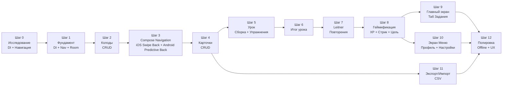
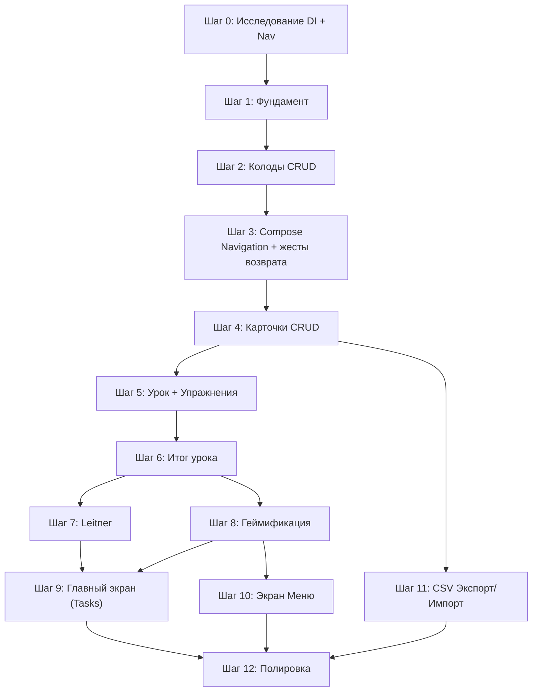

# Repetrail — Master Plan

> **Цель:** Довести KMP-приложение для интервального повторения карточек до презентабельного MVP на Android и iOS.
> **Дата создания:** 2026-11-04
> **Последнее обновление:** 2026-11-06

---

## Принятые решения

| Аспект | Решение |
|---|---|
| Платформы | Android + iOS (Compose Multiplatform, полноценно) |
| Архитектура | MVI + AndroidX KMP ViewModel с Koin, привязка модели к записи навигационного стека; переход с Voyager ScreenModel на шаге 3 |
| Модульность | Feature-per-module (`feature:*`, `core:*`) |
| БД | Room (KMP) |
| Экспорт/Импорт | CSV (Excel-совместимый, `;` разделитель) |
| Алгоритм повторений | Leitner (5 коробок: 1 / 3 / 7 / 14 / 30 дней) |
| Урок | до 10 карточек (новые + на повторение) |
| Упражнения | 1) Flashcard (Знаю / Не знаю) 2) Quiz (4 варианта); Quiz только при ≥ 4 карточках в колоде |
| Итог урока | Правильных/неправильных + список ошибок + XP |
| XP | 10 XP за завершённый урок |
| Дневная цель | 1 урок/день (фикс) |
| Стрик | ≥1 урок за календарный день = день засчитан |
| Навигация | Compose Navigation (мультиплатформенная библиотека JetBrains, NavHost / NavController); переход с текущего Voyager — следующий этап, шаг 3 |
| DI | Koin (Runtime DI, де-факто стандарт KMP, выбран на Шаге 0) |
| UX-паттерны | Подтверждение удаления колоды в bottom sheet с немедленным удалением из БД; undo для колод отложен на будущее; skeleton-загрузка; диалоги подтверждения для деструктивных действий |

**Решение от 2026-11-06:** после CRUD колод следующим этапом выполняем переход с Voyager на Compose Navigation с iOS swipe back и Android predictive back. Первоначальный выбор Voyager и результаты шагов 0–2 сохраняются как история реализации; миграция ещё не выполнена. Новые экраны, начиная с CRUD карточек, реализуем уже на Compose Navigation.

---

## Обзор шагов



---

## Шаг 0 — Исследование: навигация и DI

### Что делаем
Исследуем, выбираем и фиксируем стек навигации и DI для KMP-проекта. Это **блокирующий** шаг — от него зависит структура всех модулей.

### Навигация — кандидаты

| Библиотека | Плюсы | Минусы |
|---|---|---|
| **Voyager** | Простой API, Screen-based, хорошая KMP-поддержка, большое сообщество | Менее гибкий deep linking, автор — одиночка |
| **Decompose** | Мощный lifecycle management, не привязан к Compose, отличная поддержка KMP, deep links | Крутая кривая обучения, boilerplate |
| **Compose Navigation (JetBrains)** | Официальный от JetBrains для CMP, минимальный boilerplate | Относительно новый, может быть менее зрелый |

### DI — кандидаты

| Библиотека | Плюсы | Минусы |
|---|---|---|
| **Koin** | De-facto стандарт для KMP, простой, runtime DI | Нет compile-time safety, ошибки в рантайме |
| **kotlin-inject** | Compile-time, KSP-based, похож на Dagger по духу | Меньшее сообщество, чуть больше boilerplate |
| **Dagger/Hilt** | Ты с ним знаком, compile-time | ❌ **Не поддерживает KMP / iOS**. Генерирует Java-код. |

> [!IMPORTANT]
> **Dagger/Hilt нельзя использовать в KMP-проекте**, т.к. он генерирует Java-код и не компилируется под iOS/Native. Ближайший аналог по духу (compile-time, annotation-based) — **kotlin-inject**. Если хочется простоты и быстрого старта — **Koin**.

### Критерии готовности
- [x] Прочитана документация по 2-3 навигационным библиотекам
- [x] Создан throwaway-бранч с минимальным PoC навигации (Отменено: решено выбрать по теоретической базе)
- [x] Прочитана документация по Koin и kotlin-inject
- [x] Создан PoC с DI (Отменено: решено выбрать по теоретической базе)
- [x] **Решение зафиксировано** в этом документе (обновить таблицу выше)

---

## Шаг 1 — Фундамент: DI + Навигация + Room

### Что делаем
Подключаем выбранные DI и навигацию по всему проекту. Настраиваем Room KMP. Создаём базовую инфраструктуру для feature-модулей.

### К чему стремимся
- Работающий граф навигации: три таба (Tasks, Cards, Menu) через выбранную библиотеку вместо `when(selectedTab)`
- Room-база v1 с DeckEntity и FlashcardEntity, DAO, FK, индексом и каскадным удалением; схема подготовлена заранее для CRUD колод и карточек (теперь шаги 2 и 4)
- Модуль `core:data` с Room-конфигурацией (общий для всех фич)
- Модуль `core:domain` для domain-моделей и use-case интерфейсов
- MVI (State / Intent / SideEffect / ScreenModel) описан как соглашение с примером, без обязательного базового класса
- DI-граф собирается на обеих платформах

### Новые модули
```
core:data          — Room DB, entity, DAO, репозитории
core:domain        — Domain-модели, use-case интерфейсы
core:common        — Источник текущего времени; CoroutineDispatcher внедряется напрямую
```

### Критерии готовности
- [x] Навигация работает на Android и iOS (три таба + вложенная навигация внутри таба): подтверждено пользователем
- [x] Созданы core:common, core:domain и core:data, подключены к shared
- [x] Подготовлены Room v1, Deck + Flashcard, DAO и платформенные builders; JSON-схема хранится в Git
- [x] Зарегистрированы общий и платформенные DI-графы, инициализация из Application / до ComposeUIViewController
- [x] Есть соглашение MVI с примером (State / Intent / SideEffect / ScreenModel)
- [x] Выбран штатный Voyager ScreenModel с Koin; экспериментальная AndroidX KMP lifecycle-интеграция удалена
- [ ] Подтверждены операции Room, сохранность после переоткрытия, FK и каскадное удаление на обеих платформах — проверка отложена
- [ ] Подтверждено реальное разрешение БД/DAO из DI на обеих платформах — проверка отложена
- [ ] Проверены lifecycle ScreenModel, восстановление после поворота и поведение после перезапуска процесса — проверка отложена

Реализация инфраструктуры шага 1 подготовлена. Пользователь подтвердил работу навигации на Android/iOS; агент не запускал новые сборки и тесты по его просьбе. MVI-тесты и lifecycle harness удалены пользователем, новые тесты пока не добавляем. Непроверенные пункты выше не считаются выполненными.

Предыдущей схемы БД нет: миграция для v1 не требуется; реальную миграцию добавляем при первом изменении схемы. `AppDispatchers` удалён по итогам ревью. Подробности и результаты: [STEP_1_FOUNDATION.md](STEP_1_FOUNDATION.md).

---

## Шаг 2 — Колоды (CRUD)

### Что делаем
Полный цикл работы с колодами: создание, просмотр списка, редактирование, удаление. Таб «Колоды» становится рабочим экраном со списком колод из БД.

### К чему стремимся
- Экран списка колод (заменяет текущий демо-список в `CardsScreen`)
- Экран создания/редактирования колоды (название, описание)
- Редактирование и удаление колоды: долгое нажатие → контекстное меню «Редактировать / Удалить». Свайп влево не реализован и исключён из требований шага 2 с разрешения разработчика от 2026-11-06
- Bottom sheet подтверждения удаления: «Колода «{name}» и все её карточки ({N}) будут удалены»; подтверждение сразу удаляет запись из БД
- Snackbar при создании: «Колода «{name}» создана»
- **Изменение решения:** snackbar с undo при удалении колоды не реализован и отложен на будущее. Сейчас используется прямое удаление из БД после подтверждения в bottom sheet (см. [STEP_2_DECKS.md, 2.8](STEP_2_DECKS.md#28-удаление-с-undo--отложено))
- Пустое состояние: иллюстрация + «Пока нет ни одной колоды» + кнопка «Создать колоду»
- Валидация: название обязательно, ошибка «Введите название колоды»; при уходе с несохранёнными изменениями — диалог «Отменить изменения?»
- Room entity `DeckEntity`, DAO, Repository, UseCase

### Модель данных
```
Deck:
  - id: Long (autoGenerate)
  - name: String
  - description: String?
  - createdAt: Long (timestamp)
  - updatedAt: Long (timestamp)
```

### Новый модуль
```
feature:deck       — Список колод, создание/редактирование колоды
```

### Критерии готовности
- [ ] Можно создать колоду с названием и описанием
- [ ] Список колод отображается из БД (не захардкожен)
- [ ] Можно отредактировать и удалить колоду
- [ ] **Отложено, не выполнено:** добавить snackbar с undo при удалении колоды в будущем; не блокирует текущий шаг
- [ ] Валидация формы: пустое название блокирует сохранение, выход с изменениями требует подтверждения
- [ ] Пустое состояние отображается корректно
- [ ] Данные сохраняются между перезапусками
- [ ] Работает на Android и iOS

---

## Шаг 3 — Переход на Compose Navigation и жесты возврата

### Что делаем
Переносим существующие экраны с Voyager на мультиплатформенную Compose Navigation (`NavHost` / `NavController`). Подключаем интерактивный iOS swipe back и Android predictive back до реализации новых экранов карточек. Переносим экранные модели на AndroidX KMP ViewModel с Koin, сохраняя MVI (State / Intent / SideEffect).

### К чему стремимся
- Типобезопасные маршруты с Kotlin Serialization; в форму передаётся только `deckId`, создание и редактирование остаются разными сценариями одного экрана
- Три таба Tasks / Cards / Menu с сохранением отдельных стеков и UI-состояния при переключении; повторное нажатие активного таба не меняет стек
- Перенесены все существующие переходы: список колод → создание/редактирование колоды и Меню → О приложении; стартовый таб Tasks и floating navigation bar сохранены
- Экранные модели списка колод и формы принадлежат соответствующим записям навигационного стека: не пересоздаются при рекомпозиции и переключении табов, освобождаются при окончательном удалении записи
- На iOS экран следует за пальцем при свайпе от края, предыдущий экран виден во время перехода; жест можно завершить или отменить
- На поддерживаемых версиях Android переход между экранами следует за системным predictive back; на остальных версиях работает обычный возврат
- Кнопка «Назад», системный Back и жесты используют одну проверку несохранённых изменений: форма остаётся открытой до подтверждения выхода, отмена жеста не удаляет запись из стека и не показывает подтверждение
- При открытой клавиатуре, диалоге или bottom sheet возврат обрабатывается соответствующим слоем без случайного выхода из формы; на корневом экране Android Back передаётся системе
- Общий подход к маршрутам и владению ViewModel описан для последующих feature-модулей; бизнес-логика CRUD, Room и существующий визуальный стиль сохраняются

### Порядок миграции
1. Подобрать совместимые с текущим Kotlin / Compose Multiplatform версии Navigation Compose, Kotlin Serialization, AndroidX Lifecycle и интеграции Koin ViewModel; зафиксировать их в version catalog.
2. Заменить `TabNavigator`, вложенные `Navigator`, Voyager `Screen` и вызовы `push/pop` на маршруты и графы Compose Navigation в `shared` и `feature:deck`.
3. Перенести `DeckListScreenModel` и `DeckFormScreenModel` на AndroidX KMP ViewModel, обновить DI и coroutine scopes; сохранить состояния, intents и side effects. Определить восстановление введённых данных формы через `SavedStateHandle`.
4. Подключить платформенные жесты и единую обработку выхода из формы. Проверить, что настройки переходов и обработчики Back сохраняют интерактивную анимацию.
5. После переноса удалить зависимости и импорты Voyager, обновить MVI-соглашение и актуальные инструкции в документации. Историю шагов 0–2 явно отделить от нового соглашения.

### Критерии готовности
- [ ] Все существующие экраны и переходы работают через Compose Navigation на Android и iOS
- [ ] Стеки табов, позиция списка и введённые данные формы сохраняются при переключении вкладок и отмене жеста
- [ ] iOS swipe back следует за пальцем и корректно завершается или отменяется
- [ ] Android predictive back работает между экранами на поддерживаемых версиях; обычный Back и выход из корневого экрана работают корректно
- [ ] Все способы возврата из изменённой формы требуют подтверждения; отмена подтверждения сохраняет введённые данные
- [ ] Клавиатура, диалоги, bottom sheet и контекстное меню списка колод не конфликтуют с жестами возврата
- [ ] Проверены владение ViewModel, освобождение после выхода, Android rotation и восстановление формы после пересоздания процесса
- [ ] Зависимости Voyager и его использование удалены из production-кода; новое соглашение MVI и навигации задокументировано
- [ ] CRUD колод и переход Меню → О приложении работают без регрессий на обеих платформах

### Документация для реализации
- [Compose Navigation: маршруты, стеки и iOS back gesture](https://kotlinlang.org/docs/multiplatform/compose-navigation.html)
- [Android predictive back в Navigation Compose](https://developer.android.com/develop/ui/compose/system/predictive-back-setup)

---

## Шаг 4 — Карточки (CRUD)

### Что делаем
Внутри колоды: создание, просмотр, редактирование и удаление карточек. Экран «Детали колоды» со статистикой и списком карточек.

### К чему стремимся
- Экран деталей колоды: шапка со статистикой (всего / новые / на повторение) + список карточек
- Экран создания/редактирования карточки: термин, определение, пример (необязательный)
- Кнопка «Сохранить и добавить ещё» при создании — сохраняет карточку, очищает поля, остаётся на экране
- Удаление карточки: свайп влево → кнопка «Удалить»; snackbar «Карточка удалена» + undo
- Показ количества карточек в каждой колоде на экране списка колод
- Валидация: термин и определение обязательны, ошибка «Обязательное поле»
- Пустое состояние: «В этой колоде пока нет карточек» + «Добавить первую карточку»
- Меню (⋮) в toolbar деталей колоды: Редактировать колоду / Удалить колоду

### Модель данных
```
Card:
  - id: Long (autoGenerate)
  - deckId: Long (FK → Deck)
  - term: String
  - definition: String
  - example: String?    — необязательный
  - createdAt: Long
```

### Карточка в списке показывает
- **Термин** (жирный) + **Определение** (серый, до 2 строк)
- Бейдж **«Новая»** для карточек без lastReviewedAt (визуальный статус добавляется на шаге 7)

### Новый модуль
```
feature:card       — Список карточек колоды, создание/редактирование карточки
```

### Критерии готовности
- [ ] Из экрана колоды можно перейти в список карточек
- [ ] Можно создать карточку с термином, определением и необязательным примером
- [ ] Работает «Сохранить и добавить ещё»
- [ ] Карточку можно редактировать и удалять (с undo)
- [ ] На экране колод видно количество карточек
- [ ] Валидация формы и пустое состояние работают
- [ ] Работает на Android и iOS

---

## Шаг 5 — Урок: сборка и упражнения

### Что делаем
Механика одного урока: выбор карточек, два типа упражнений, прохождение. Полноэкранный экран поверх табов.

### К чему стремимся
- Кнопка «Начать урок» на экране деталей колоды. Недоступна если карточек = 0
- Сборка урока: до 10 карточек (новые + на повторение по Leitner, но пока без Leitner — просто случайные)
- **Две фазы урока:** сначала все flashcard, потом все quiz
- **Упражнение 1 — Flashcard:** показ термина → «Показать ответ» (с flip-анимацией) → определение + пример → «Знаю ✅» / «Не знаю ❌»
- **Упражнение 2 — Quiz:** показ термина → 4 варианта ответа (1 правильный + 3 рандомных из этой колоды) → подсветка правильного/неправильного → «Далее»
- **Особый случай: < 4 карточек в колоде** → фаза Quiz невозможна, урок состоит только из Flashcard (N упражнений вместо 2N)
- Прогресс-бар сверху экрана: «3 / 20» (или «3 / N» при отсутствии quiz)
- Кнопка ✕ (выход): диалог «Выйти из урока? Прогресс не сохранится.» → Выйти / Продолжить
- Системный back gesture → тот же диалог подтверждения

### Новый модуль
```
feature:lesson     — Экран урока, логика сборки, упражнения
```

### Критерии готовности
- [ ] Урок запускается и показывает до 10 карточек
- [ ] Flashcard-упражнение работает (показ/скрытие ответа с анимацией, Знаю/Не знаю)
- [ ] Quiz-упражнение работает (4 варианта, подсветка правильного/неправильного, кнопка «Далее»)
- [ ] При < 4 карточках quiz-фаза пропускается, урок идёт только flashcard
- [ ] Прогресс-бар отображает текущую позицию из общего числа
- [ ] Выход из урока требует подтверждения через диалог
- [ ] Ответы сохраняются в памяти для передачи в итог
- [ ] Работает на Android и iOS

---

## Шаг 6 — Итог урока

### Что делаем
Экран результатов после завершения урока. Полноэкранный, заменяет экран урока.

### К чему стремимся
- Заголовок: «Урок завершён!» (или «Отличная работа!» при ≥ 80% правильных)
- Статистика: ✅ Правильных / ❌ Неправильных + процент + круговая диаграмма
- XP: «+10 XP заработано ⭐» (отображение; начисление — на шаге 8)
- Раздел «Разбор ошибок»: свёрнутый по умолчанию список (термин → что ответил → правильный ответ)
- Кнопки: «Повторить урок» (primary) / «К колоде» (secondary) / «На главную» (text)
- Confetti-анимация при ≥ 80% правильных (nice-to-have, можно отложить до шага 12)
- Системный back gesture → возврат к деталям колоды

### Новый модуль
```
feature:lesson-result  — Экран итога урока
```

### Критерии готовности
- [ ] После завершения урока показывается экран итогов
- [ ] Видна статистика: правильных / неправильных / процент
- [ ] Список ошибок с разбором (термин, неверный ответ, верный ответ)
- [ ] Кнопки навигации работают: повторить, к колоде, на главную
- [ ] Работает на Android и iOS

---

## Шаг 7 — Leitner: система повторений

### Что делаем
Подключаем алгоритм Leitner для планирования повторений.

### К чему стремимся
- Каждая карточка получает `box` (1–5) и `nextReviewAt` (timestamp)
- Новые карточки начинают в box 1
- Правильный ответ → карточка переходит в следующую коробку (box + 1, макс 5)
- Неправильный ответ → карточка возвращается в box 1
- Интервалы: Box 1 = 1 день, Box 2 = 3 дня, Box 3 = 7 дней, Box 4 = 14 дней, Box 5 = 30 дней
- Сборка урока теперь учитывает `nextReviewAt`: сначала карточки, которые пора повторить, потом новые
- На экране деталей колоды: статистика «На повторение: X» / «Новые: X» / «Выучены: X»
- Карточка в списке получает бейдж с номером коробки Leitner (цвет: 1 = красный → 5 = зелёный) и статус: «Новая» / «На повторение» / «Выучена»
- На экране списка колод: «N на повторение» рядом с каждой колодой + мини-индикатор распределения по коробкам

### Расширение модели
```
Card (добавляются поля):
  - box: Int (1..5, default = 1)
  - nextReviewAt: Long (timestamp, default = createdAt)
  - lastReviewedAt: Long? (nullable)
```

> [!NOTE]
> Это первое изменение схемы Room — необходимо добавить миграцию v1 → v2.

### Критерии готовности
- [ ] После урока карточки меняют box и nextReviewAt в БД
- [ ] Сборка урока приоритизирует карточки с `nextReviewAt <= сейчас`
- [ ] На экране деталей колоды видна статистика: на повторение / новые / выучены
- [ ] На экране списка колод видно «X на повторение» и мини-индикатор Leitner
- [ ] Карточки в списке показывают бейдж коробки и статус
- [ ] Миграция Room v1 → v2 работает корректно
- [ ] Работает на Android и iOS

---

## Шаг 8 — Геймификация: XP, стрик, дневная цель

### Что делаем
Система прогресса: XP, стрик (серия дней), дневная цель.

### К чему стремимся
- **XP:** +10 за каждый завершённый урок. Суммарный XP хранится в БД. Отображается на экране итога урока (шаг 6 уже показывает UI, здесь подключаем логику начисления)
- **Дневная цель:** 1 урок/день (фикс). Виджет: «Сегодня: 0/1 урок»
- **Стрик:** количество непрерывных дней, когда была достигнута дневная цель
  - Если `lastActiveDate == вчера` и сегодня цель достигнута → streak + 1
  - Если `lastActiveDate < вчера` → streak сбрасывается на 1
- На экране итога урока: «🔥 Серия: N дней!» (если обновился), «✅ Дневная цель достигнута!» (если первый урок сегодня)

### Модель данных
```
UserProgress:
  - id: Long (single row, id = 1)
  - totalXp: Int
  - currentStreak: Int
  - longestStreak: Int
  - lastActiveDate: String (ISO date, e.g. "2026-11-04")
  - lessonsCompletedToday: Int
  - totalLessonsCompleted: Int
  - totalCardsLearned: Int
```

### Новый модуль
```
feature:progress   — Логика XP, стрика, дневной цели; виджеты для использования на других экранах
```

### Критерии готовности
- [ ] XP начисляется после завершения урока
- [ ] Экран итога урока показывает заработанный XP, обновлённый стрик, достижение дневной цели
- [ ] Стрик корректно считается (непрерывные дни)
- [ ] Стрик сбрасывается при пропуске дня
- [ ] `totalLessonsCompleted` и `totalCardsLearned` обновляются
- [ ] Работает на Android и iOS

---

## Шаг 9 — Главный экран: таб «Задания» (Tasks)

### Что делаем
Реализуем полноценный главный экран (таб «Задания»), который является точкой входа и мотивационным хабом.

### К чему стремимся
- **Приветствие:** «Привет! 👋» + текущая дата
- **Виджет стрика:** 🔥 текущий стрик. Если стрик = 0: «Начни серию сегодня!»
- **Дневная цель:** прогресс-бар «Сегодня: 0/1 урок». Если выполнено: галочка + «Цель достигнута! 🎉»
- **XP:** ⭐ общее количество XP
- **Карточки на повторение:** сводка «12 карточек ждут повторения» (суммарно по всем колодам). Если 0: «Всё повторено! Отлично!»
- **Быстрые действия:** список колод, в которых есть карточки на повторение, с кнопкой «Начать урок» у каждой → полноэкранный экран урока
- **Пустое состояние** (нет колод): иллюстрация + «У тебя пока нет колод» + кнопка «Создать первую колоду» → переход на таб Колоды → экран создания колоды

### Зависимости
- Данные стрика, XP, дневной цели — из `feature:progress` (шаг 8)
- Данные о карточках на повторение — из `core:data` (Leitner, шаг 7)
- Запуск урока — `feature:lesson` (шаг 5)

### Критерии готовности
- [ ] Экран Tasks показывает приветствие, стрик, XP, дневную цель
- [ ] Показывается сводка карточек на повторение (суммарно по всем колодам)
- [ ] Список колод с карточками на повторение + кнопка «Начать урок»
- [ ] При тапе «Начать урок» → полноэкранный урок для выбранной колоды
- [ ] Пустое состояние работает корректно
- [ ] Кросс-навигация: кнопка «Создать первую колоду» переключает на таб Колоды
- [ ] Работает на Android и iOS

---

## Шаг 10 — Экран «Меню»: профиль и настройки

### Что делаем
Реализуем полноценный экран меню (таб «Меню»): профиль пользователя, статистика, служебные функции.

### К чему стремимся
- **Профиль-секция:** аватар-заглушка, общий XP, текущий стрик, лучший стрик
- **Статистика:** всего уроков пройдено, всего карточек выучено (данные из `UserProgress`)
- **Пункты меню:**
  - **Импорт колоды (CSV)** → системный file picker → парсинг → создание колоды (если шаг 11 готов; иначе пункт скрыт)
  - **О приложении** → диалог с версией приложения
  - **Сбросить прогресс** → диалог подтверждения: «XP и стрик будут сброшены. Колоды и карточки сохранятся.» → сброс `UserProgress`

### Критерии готовности
- [ ] Экран меню показывает XP, текущий стрик, лучший стрик
- [ ] Статистика отображается корректно
- [ ] «О приложении» открывает диалог с версией
- [ ] «Сбросить прогресс» сбрасывает XP и стрик через диалог подтверждения
- [ ] Работает на Android и iOS

---

## Шаг 11 — Экспорт / Импорт колод (CSV)

### Что делаем
Возможность экспортировать колоду в CSV и импортировать из CSV.

### К чему стремимся
- **Экспорт:** меню (⋮) на экране деталей колоды → «Экспорт в CSV» → генерация CSV → системный share sheet
- **Экспорт из списка:** долгое нажатие на колоду → контекстное меню → «Экспорт в CSV»
- **Импорт:** кнопка импорта в toolbar списка колод + пункт «Импорт колоды» в меню → системный file picker → парсинг CSV → диалог подтверждения «Импортировать N карточек в колоду «{filename}»?» → создание колоды
- Формат CSV:
  ```
  term;definition;example
  "Dog";"Собака";"The dog is barking"
  "Cat";"Кошка";""
  ```
- Имя файла = название колоды + `.csv`
- Обработка ошибок: невалидный CSV → диалог «Не удалось прочитать файл. Проверьте формат CSV.»; пустые обязательные поля → пропуск строки с warning
- Snackbar при успешном импорте: «Импортировано {N} карточек в колоду «{name}»»
- Snackbar при успешном экспорте: «Колода экспортирована»

### Новый модуль
```
feature:import-export  — CSV экспорт/импорт
```

### Критерии готовности
- [ ] Экспорт колоды создаёт корректный CSV с UTF-8 BOM для Excel
- [ ] CSV корректно открывается в Excel / Google Sheets
- [ ] Импорт из CSV создаёт новую колоду с карточками
- [ ] Диалог подтверждения импорта с количеством карточек
- [ ] Ошибки при импорте показываются пользователю (диалог)
- [ ] Snackbar-уведомления при импорте/экспорте
- [ ] Работает на Android и iOS (platform-specific file pickers)

---

## Шаг 12 — Полировка: оффлайн, UX, стабильность

### Что делаем
Финальная полировка, убеждаемся что всё работает оффлайн, ловим баги, доводим визуал.

### К чему стремимся
- **Оффлайн:** приложение полностью работает без интернета (Room = локально, так что в основном уже готово). Проверить, что ничто не зависит от сети
- **Empty states:** ревью всех пустых состояний — все должны иметь иллюстрацию, текст и CTA
- **Loading states:** skeleton-загрузка на всех экранах с данными из БД (не спиннеры)
- **Error handling:** обработка edge cases:
  - Удалить колоду с карточками → каскадное удаление (уже реализовано в Room)
  - Пустая колода → кнопка «Начать урок» недоступна с пояснением
  - Ошибка БД → полноэкранное «Что-то пошло не так» + «Попробовать снова»
- **Анимации:**
  - Flip-анимация flashcard (если не реализована на шаге 5)
  - Confetti на экране итога урока при ≥ 80%
  - Переходы между экранами
- **Accessibility:** contentDescription для иконок, минимальные размеры tap targets (48dp)
- **Навигация назад:** проверить корректность на всех экранах (см. [USER_FLOW.md](USER_FLOW.md) § «Навигация назад»)
- **Undo:** проверить что undo при удалении работает корректно для колод и карточек

### Критерии готовности
- [ ] Приложение работает в airplane mode от начала до конца
- [ ] Все пустые состояния имеют осмысленные заглушки с CTA
- [ ] Все экраны с данными используют skeleton-загрузку
- [ ] Нет крашей на edge cases
- [ ] Навигация назад работает корректно на обеих платформах (в т.ч. диалоги подтверждения при уходе с формы)
- [ ] Undo при удалении работает для колод и карточек
- [ ] Визуально приложение выглядит цельно и «презентабельно»
- [ ] Работает на Android и iOS

---

## Итоговая структура модулей

```
Repetrail/
├── androidApp/                    — Android entry point
├── iosApp/                        — iOS entry point
├── shared/                        — Compose UI shell, главный навигационный граф
├── core/
│   ├── ui/designsystem/           — ✅ уже есть, тема, токены, компоненты
│   ├── data/                      — Room DB, entity, DAO, миграции
│   ├── domain/                    — Domain-модели, use-case интерфейсы
│   └── common/                    — Источник времени, общие утилиты
├── feature/
│   ├── add_card/                  — ⚠️ будет удалён (шаблон)
│   ├── deck/                      — Список колод, CRUD колоды
│   ├── card/                      — Детали колоды, список карточек, CRUD карточки
│   ├── lesson/                    — Урок: сборка, flashcard, quiz
│   ├── lesson-result/             — Итог урока
│   ├── progress/                  — XP, стрик, дневная цель (виджеты + логика)
│   ├── home/                      — Таб «Задания»: мотивационный хаб, быстрый старт уроков
│   ├── menu/                      — Таб «Меню»: профиль, статистика, настройки
│   └── import-export/             — CSV экспорт/импорт
```

> [!NOTE]
> Модуль `feature:add_card` — это шаблон, сгенерированный Android Studio. Он будет удалён или заменён модулями `feature:deck` и `feature:card`.

> [!NOTE]
> Модули `feature:home` и `feature:menu` — новые по сравнению с первоначальным планом. Они реализуют полноценные экраны табов «Задания» и «Меню», которые ранее не были выделены в отдельные шаги.

---

## Порядок и зависимости



> [!TIP]
> **Шаги 7, 8, 11** можно делать параллельно после завершения шага 6 (7 и 8) и шага 4 (11) — они не зависят друг от друга.
> **Шаг 9** (главный экран Tasks) зависит от шагов 7 и 8, т.к. ему нужны данные Leitner и геймификации.
> **Шаг 10** (меню) зависит от шага 8, т.к. отображает XP/стрик/статистику.

---

## Связанные документы

| Документ | Описание |
|---|---|
| [USER_FLOW.md](USER_FLOW.md) | Детальное описание пользовательского флоу: экраны, действия, диалоги, состояния, навигация |
| [STEP_0_RESEARCH.md](STEP_0_RESEARCH.md) | Результаты исследования DI и навигации |
| [STEP_1_FOUNDATION.md](STEP_1_FOUNDATION.md) | Подробности реализации фундамента |
