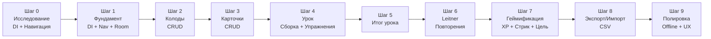
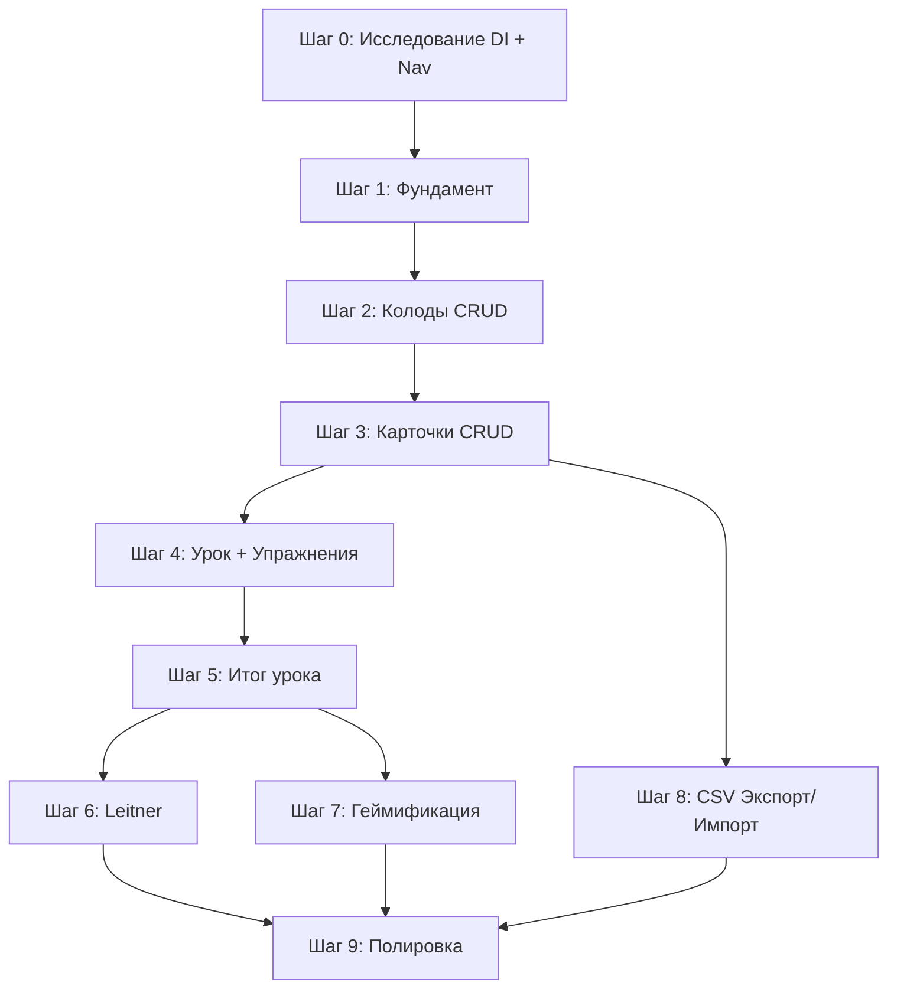

# Repetrail — Master Plan

> **Цель:** Довести KMP-приложение для интервального повторения карточек до презентабельного MVP на Android и iOS.
> **Дата создания:** 2026-11-04

---

## Принятые решения

| Аспект | Решение |
|---|---|
| Платформы | Android + iOS (Compose Multiplatform, полноценно) |
| Архитектура | MVI + Voyager ScreenModel; экранная модель через koinScreenModel, корутины в screenModelScope |
| Модульность | Feature-per-module (`feature:*`, `core:*`) |
| БД | Room (KMP) |
| Экспорт/Импорт | CSV (Excel-совместимый, `;` разделитель) |
| Алгоритм повторений | Leitner (5 коробок: 1 / 3 / 7 / 14 / 30 дней) |
| Урок | 10 карточек (фикс), новые + на повторение |
| Упражнения | 1) Flashcard (Знаю / Не знаю) 2) Quiz (4 варианта) |
| Итог урока | Правильных/неправильных + список ошибок + XP |
| XP | 10 XP за завершённый урок |
| Дневная цель | 1 урок/день (фикс) |
| Стрик | ≥1 урок за календарный день = день засчитан |
| Навигация | Voyager (Screen-based, минимум boilerplate, выбран на Шаге 0) |
| DI | Koin (Runtime DI, де-факто стандарт KMP, выбран на Шаге 0) |

---

## Обзор шагов



---

## Шаг 0 — Исследование: навигация и DI

### Что делаем
Исследуем, выбираем и фиксируем стек навигации и DI для KMP-проекта. Это **блокирующий** шаг — от него зависит структура всех модулей.

### Навигация — кандидаты

| Библиотека | Плюсы | Минусы |
|---|---|---|
| **Voyager** | Простой API, Screen-based, хорошая KMP-поддержка, большое сообщество | Менее гибкий deep linking, автор — одиночка |
| **Decompose** | Мощный lifecycle management, не привязан к Compose, отличная поддержка KMP, deep links | Крутая кривая обучения, boilerplate |
| **Compose Navigation (JetBrains)** | Официальный от JetBrains для CMP, минимальный boilerplate | Относительно новый, может быть менее зрелый |

### DI — кандидаты

| Библиотека | Плюсы | Минусы |
|---|---|---|
| **Koin** | De-facto стандарт для KMP, простой, runtime DI | Нет compile-time safety, ошибки в рантайме |
| **kotlin-inject** | Compile-time, KSP-based, похож на Dagger по духу | Меньшее сообщество, чуть больше boilerplate |
| **Dagger/Hilt** | Ты с ним знаком, compile-time | ❌ **Не поддерживает KMP / iOS**. Генерирует Java-код. |

> [!IMPORTANT]
> **Dagger/Hilt нельзя использовать в KMP-проекте**, т.к. он генерирует Java-код и не компилируется под iOS/Native. Ближайший аналог по духу (compile-time, annotation-based) — **kotlin-inject**. Если хочется простоты и быстрого старта — **Koin**.

### Критерии готовности
- [x] Прочитана документация по 2-3 навигационным библиотекам
- [x] Создан throwaway-бранч с минимальным PoC навигации (Отменено: решено выбрать по теоретической базе)
- [x] Прочитана документация по Koin и kotlin-inject
- [x] Создан PoC с DI (Отменено: решено выбрать по теоретической базе)
- [x] **Решение зафиксировано** в этом документе (обновить таблицу выше)

---

## Шаг 1 — Фундамент: DI + Навигация + Room

### Что делаем
Подключаем выбранные DI и навигацию по всему проекту. Настраиваем Room KMP. Создаём базовую инфраструктуру для feature-модулей.

### К чему стремимся
- Работающий граф навигации: три таба (Tasks, Cards, Menu) через выбранную библиотеку вместо `when(selectedTab)`
- Room-база v1 с DeckEntity и FlashcardEntity, DAO, FK, индексом и каскадным удалением; схема подготовлена заранее для шагов 2–3
- Модуль `core:data` с Room-конфигурацией (общий для всех фич)
- Модуль `core:domain` для domain-моделей и use-case интерфейсов
- MVI (State / Intent / SideEffect / ScreenModel) описан как соглашение с примером, без обязательного базового класса
- DI-граф собирается на обеих платформах

### Новые модули
```
core:data          — Room DB, entity, DAO, репозитории
core:domain        — Domain-модели, use-case интерфейсы
core:common        — Источник текущего времени; CoroutineDispatcher внедряется напрямую
```

### Критерии готовности
- [x] Навигация работает на Android и iOS (три таба + вложенная навигация внутри таба): подтверждено пользователем
- [x] Созданы core:common, core:domain и core:data, подключены к shared
- [x] Подготовлены Room v1, Deck + Flashcard, DAO и платформенные builders; JSON-схема хранится в Git
- [x] Зарегистрированы общий и платформенные DI-графы, инициализация из Application / до ComposeUIViewController
- [x] Есть соглашение MVI с примером (State / Intent / SideEffect / ScreenModel)
- [x] Выбран штатный Voyager ScreenModel с Koin; экспериментальная AndroidX KMP lifecycle-интеграция удалена
- [ ] Подтверждены операции Room, сохранность после переоткрытия, FK и каскадное удаление на обеих платформах — проверка отложена
- [ ] Подтверждено реальное разрешение БД/DAO из DI на обеих платформах — проверка отложена
- [ ] Проверены lifecycle ScreenModel, восстановление после поворота и поведение после перезапуска процесса — проверка отложена

Реализация инфраструктуры шага 1 подготовлена. Пользователь подтвердил работу навигации на Android/iOS; агент не запускал новые сборки и тесты по его просьбе. MVI-тесты и lifecycle harness удалены пользователем, новые тесты пока не добавляем. Непроверенные пункты выше не считаются выполненными.

Предыдущей схемы БД нет: миграция для v1 не требуется; реальную миграцию добавляем при первом изменении схемы. `AppDispatchers` удалён по итогам ревью. Подробности и результаты: [STEP_1_FOUNDATION.md](STEP_1_FOUNDATION.md).

---

## Шаг 2 — Колоды (CRUD)

### Что делаем
Полный цикл работы с колодами: создание, просмотр списка, редактирование, удаление.

### К чему стремимся
- Экран списка колод (заменяет текущий демо-список в `CardsScreen`)
- Экран создания/редактирования колоды (название, описание)
- Удаление колоды (свайп или долгое нажатие → подтверждение)
- Room entity `DeckEntity`, DAO, Repository, UseCase

### Модель данных
```
Deck:
  - id: Long (autoGenerate)
  - name: String
  - description: String?
  - createdAt: Long (timestamp)
  - updatedAt: Long (timestamp)
```

### Новый модуль
```
feature:deck       — Список колод, создание/редактирование колоды
```

### Критерии готовности
- [ ] Можно создать колоду с названием и описанием
- [ ] Список колод отображается из БД (не захардкожен)
- [ ] Можно отредактировать и удалить колоду
- [ ] Данные сохраняются между перезапусками
- [ ] Работает на Android и iOS

---

## Шаг 3 — Карточки (CRUD)

### Что делаем
Внутри колоды: создание, просмотр, редактирование и удаление карточек.

### К чему стремимся
- Экран деталей колоды со списком карточек
- Экран создания/редактирования карточки: термин, определение, пример (необязательный)
- Удаление карточки
- Показ количества карточек в каждой колоде на экране списка колод

### Модель данных
```
Card:
  - id: Long (autoGenerate)
  - deckId: Long (FK → Deck)
  - term: String
  - definition: String
  - example: String?    — необязательный
  - createdAt: Long
```

### Новый модуль
```
feature:card       — Список карточек колоды, создание/редактирование карточки
```

### Критерии готовности
- [ ] Из экрана колоды можно перейти в список карточек
- [ ] Можно создать карточку с термином, определением и необязательным примером
- [ ] Карточку можно редактировать и удалять
- [ ] На экране колод видно количество карточек
- [ ] Работает на Android и iOS

---

## Шаг 4 — Урок: сборка и упражнения

### Что делаем
Механика одного урока: выбор карточек, два типа упражнений, прохождение.

### К чему стремимся
- Кнопка "Начать урок" на экране колоды (или на экране "Задания")
- Сборка урока: до 10 карточек (новые + на повторение по Leitner, но пока без Leitner — просто случайные)
- **Упражнение 1 — Flashcard:** показ термина → пользователь нажимает "Показать ответ" → видит определение (+пример) → оценивает себя "Знаю" / "Не знаю"
- **Упражнение 2 — Quiz:** показ термина → 4 варианта ответа (1 правильный + 3 рандомных из этой же колоды) → пользователь выбирает
- Порядок упражнений: сначала все flashcard, потом все quiz (или перемешать — решить при декомпозиции)
- Прогресс-бар сверху экрана

### Новый модуль
```
feature:lesson     — Экран урока, логика сборки, упражнения
```

### Критерии готовности
- [ ] Урок запускается и показывает 10 карточек
- [ ] Flashcard-упражнение работает (показ/скрытие ответа, Знаю/Не знаю)
- [ ] Quiz-упражнение работает (4 варианта, подсветка правильного/неправильного)
- [ ] Прогресс-бар отображает текущую позицию
- [ ] Ответы сохраняются в памяти для передачи в итог
- [ ] Работает на Android и iOS

---

## Шаг 5 — Итог урока

### Что делаем
Экран результатов после завершения урока.

### К чему стремимся
- Экран показывает: кол-во правильных / неправильных, заработанные XP (10)
- Список ошибок: термин → что ответил пользователь → правильный ответ
- Кнопки: "Повторить урок" / "Вернуться к колоде"
- Анимация (confetti или подобное при хорошем результате — nice-to-have)

### Новый модуль
```
feature:lesson-result  — Экран итога урока
```

### Критерии готовности
- [ ] После завершения урока показывается экран итогов
- [ ] Видна статистика: правильных / неправильных / XP
- [ ] Список ошибок с разбором (термин, неверный ответ, верный ответ)
- [ ] Кнопки навигации работают
- [ ] Работает на Android и iOS

---

## Шаг 6 — Leitner: система повторений

### Что делаем
Подключаем алгоритм Leitner для планирования повторений.

### К чему стремимся
- Каждая карточка получает `box` (1–5) и `nextReviewAt` (timestamp)
- Новые карточки начинают в box 1
- Правильный ответ → карточка переходит в следующую коробку (box + 1, макс 5)
- Неправильный ответ → карточка возвращается в box 1
- Интервалы: Box 1 = 1 день, Box 2 = 3 дня, Box 3 = 7 дней, Box 4 = 14 дней, Box 5 = 30 дней
- Сборка урока теперь учитывает `nextReviewAt`: сначала карточки, которые пора повторить, потом новые

### Расширение модели
```
Card (добавляются поля):
  - box: Int (1..5, default = 1)
  - nextReviewAt: Long (timestamp, default = createdAt)
  - lastReviewedAt: Long? (nullable)
```

### Критерии готовности
- [ ] После урока карточки меняют box и nextReviewAt в БД
- [ ] Сборка урока приоритизирует карточки с `nextReviewAt <= сейчас`
- [ ] На экране колоды видно "X карточек на повторение сегодня"
- [ ] Работает на Android и iOS

---

## Шаг 7 — Геймификация: XP, стрик, дневная цель

### Что делаем
Система прогресса: XP, стрик (серия дней), дневная цель.

### К чему стремимся
- **XP:** +10 за каждый завершённый урок. Суммарный XP хранится в БД
- **Дневная цель:** 1 урок/день (фикс). На главном экране (Tasks) виджет: "Сегодня: 0/1 урок"
- **Стрик:** количество непрерывных дней, когда была достигнута дневная цель
  - Если `lastActiveDate == вчера` и сегодня цель достигнута → streak + 1
  - Если `lastActiveDate < вчера` → streak сбрасывается на 1
- Отображение на экране Tasks / Menu: 🔥 стрик, ⭐ XP

### Модель данных
```
UserProgress:
  - id: Long (single row, id = 1)
  - totalXp: Int
  - currentStreak: Int
  - longestStreak: Int
  - lastActiveDate: String (ISO date, e.g. "2026-11-04")
  - lessonsCompletedToday: Int
```

### Критерии готовности
- [ ] XP начисляется после завершения урока
- [ ] Стрик корректно считается (непрерывные дни)
- [ ] На экране Tasks виджет с дневной целью и стриком
- [ ] Стрик сбрасывается при пропуске дня
- [ ] Работает на Android и iOS

---

## Шаг 8 — Экспорт / Импорт колод (CSV)

### Что делаем
Возможность экспортировать колоду в CSV и импортировать из CSV.

### К чему стремимся
- **Экспорт:** кнопка в экране колоды → генерация CSV → системный share sheet / сохранение в файл
- **Импорт:** кнопка на экране списка колод → выбор CSV из файловой системы → парсинг → создание колоды с карточками
- Формат CSV:
  ```
  term;definition;example
  "Dog";"Собака";"The dog is barking"
  "Cat";"Кошка";""
  ```
- Имя файла = название колоды
- Обработка ошибок: невалидный CSV, пустые обязательные поля

### Новый модуль
```
feature:import-export  — CSV экспорт/импорт
```

### Критерии готовности
- [ ] Экспорт колоды создаёт корректный CSV с UTF-8 BOM для Excel
- [ ] CSV корректно открывается в Excel / Google Sheets
- [ ] Импорт из CSV создаёт новую колоду с карточками
- [ ] Ошибки при импорте показываются пользователю
- [ ] Работает на Android и iOS (platform-specific file pickers)

---

## Шаг 9 — Полировка: оффлайн, UX, стабильность

### Что делаем
Финальная полировка, убеждаемся что всё работает оффлайн, ловим баги.

### К чему стремимся
- **Оффлайн:** приложение полностью работает без интернета (Room = локально, так что в основном уже готово). Проверить, что ничто не зависит от сети
- **Empty states:** красивые заглушки на пустых экранах (нет колод → "Создай первую колоду!")
- **Loading states:** скелетоны или спиннеры при загрузке данных
- **Error handling:** обработка edge cases:
  - Удалить колоду с карточками → каскадное удаление
  - Начать урок с < 4 карточками → невозможен quiz, только flashcard (или показать ошибку?)
  - Пустая колода → кнопка "Начать урок" недоступна
- **Анимации:** переходы между экранами, flip-анимация flashcard
- **Accessibility:** contentDescription для иконок, минимальные размеры tap targets

### Критерии готовности
- [ ] Приложение работает в airplane mode от начала до конца
- [ ] Все пустые состояния имеют осмысленные заглушки
- [ ] Нет крашей на edge cases
- [ ] Навигация назад работает корректно на обеих платформах
- [ ] Визуально приложение выглядит цельно и "презентабельно"
- [ ] Работает на Android и iOS

---

## Итоговая структура модулей

```
Repetrail/
├── androidApp/                    — Android entry point
├── iosApp/                        — iOS entry point
├── shared/                        — Compose UI shell, главный навигационный граф
├── core/
│   ├── ui/designsystem/           — ✅ уже есть, тема, токены, компоненты
│   ├── data/                      — Room DB, entity, DAO, миграции
│   ├── domain/                    — Domain-модели, use-case интерфейсы
│   └── common/                    — Источник времени, общие утилиты
├── feature/
│   ├── add_card/                  — ⚠️ будет удалён (шаблон)
│   ├── deck/                      — Список колод, CRUD колоды
│   ├── card/                      — Список карточек, CRUD карточки
│   ├── lesson/                    — Урок: сборка, flashcard, quiz
│   ├── lesson-result/             — Итог урока
│   ├── progress/                  — XP, стрик, дневная цель (виджеты для Tasks экрана)
│   └── import-export/             — CSV экспорт/импорт
```

> [!NOTE]
> Модуль `feature:add_card` — это шаблон, сгенерированный Android Studio. Он будет удалён или заменён модулями `feature:deck` и `feature:card`.

---

## Порядок и зависимости



> [!TIP]
> **Шаги 6, 7, 8** можно делать параллельно после завершения Шага 5 (6 и 7) и Шага 3 (8) — они не зависят друг от друга.
