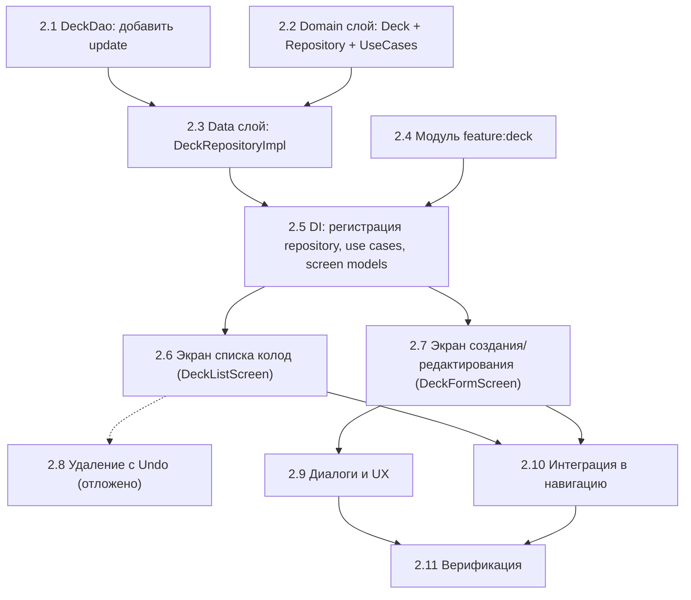

# Шаг 2 — Колоды (CRUD): Подробный план реализации

> **Автор:** Claude
> **Дата создания:** 2026-11-05
> **Базовый документ:** [STEP_2_DECKS.md](STEP_2_DECKS.md), [MASTER_PLAN.md](MASTER_PLAN.md)

---

## Обзор

Шаг 2 превращает таб «Колоды» из демо-заглушки с захардкоженными данными в полноценный CRUD-экран, работающий с Room БД. Результат: пользователь может создавать, просматривать, редактировать и удалять колоды на Android и iOS.

## Текущее состояние (на входе в Шаг 2)

| Компонент | Статус |
|---|---|
| `DeckEntity` + `DeckDao` | ✅ Готовы в `core:data` (insert, getById, observeAll, deleteById) |
| `FlashcardEntity` + `FlashcardDao` | ✅ Готовы в `core:data` |
| Room Database v1 | ✅ Настроена, схема экспортирована |
| DI-граф (Koin) | ✅ DB + DAO зарегистрированы как singleton |
| `core:domain` | ⚠️ Пустой (нет моделей, интерфейсов, use cases) |
| `feature:deck` | ❌ Не существует |
| `CardsScreen` | ⚠️ Демо-заглушка с 30 захардкоженными элементами |
| Навигация (Voyager) | ✅ 3 таба + вложенная навигация работают |
| MVI соглашение | ✅ Зафиксировано (State/Intent/SideEffect/ScreenModel) |
| `feature:add_card` | ⚠️ Шаблон, будет удалён/заменён позже |

---

## Порядок выполнения



---

## Task list

### 2.1. Расширить DeckDao

**Зачем:** Текущий DAO не поддерживает update — нужен для редактирования колоды.

- [x] Добавить `@Update suspend fun update(deck: DeckEntity)` в `DeckDao`
- [x] Добавить `@Query("SELECT COUNT(*) FROM flashcards WHERE deckId = :deckId") suspend fun getFlashcardCount(deckId: Long): Int` в `DeckDao` (для отображения кол-ва карточек и текста в диалоге удаления)
- [x] Убедиться, что `observeAll()` возвращает колоды с сортировкой по `updatedAt DESC` (или оставить `createdAt DESC` — определить при реализации, но `updatedAt DESC` логичнее, чтобы недавно отредактированные были выше)

> [!NOTE]
> `FlashcardDao` пока не трогаем — количество карточек для отображения в списке колод можно получить через `DeckDao` с JOIN-запросом или отдельным query. Простой вариант — query `COUNT(*)` в `DeckDao`.

**Файлы:**
- `core/data/src/commonMain/kotlin/com/breckneck/core/data/local/dao/DeckDao.kt`

**Готово, когда:** DAO поддерживает полный CRUD + подсчёт карточек.

---

### 2.2. Domain слой: модель Deck, DeckRepository, UseCases

**Зачем:** `core:domain` сейчас пустой. Нужно создать domain-модель `Deck`, интерфейс репозитория и use cases — всё без зависимостей от Room, Koin, Compose.

- [x] Создать `core/domain/src/commonMain/kotlin/com/breckneck/core/domain/model/Deck.kt`:
  ```kotlin
  data class Deck(
      val id: Long = 0,
      val name: String,
      val description: String?,
      val cardCount: Int = 0,    // вычисляемое поле, заполняется репозиторием
      val createdAt: Long,
      val updatedAt: Long,
  )
  ```
- [x] Создать интерфейс `core/domain/src/commonMain/kotlin/com/breckneck/core/domain/repository/DeckRepository.kt`:
  ```kotlin
  interface DeckRepository {
      fun observeDecks(): Flow<List<Deck>>
      suspend fun getDeckById(id: Long): Deck?
      suspend fun saveDeck(deck: Deck): Long   // insert или update
      suspend fun deleteDeck(id: Long)
      suspend fun getFlashcardCount(deckId: Long): Int
  }
  ```
- [x] Создать use cases в `core/domain/src/commonMain/kotlin/com/breckneck/core/domain/usecase/deck/`:
  - `ObserveDecksUseCase` — обёртка над `repository.observeDecks()`
  - `GetDeckByIdUseCase` — обёртка над `repository.getDeckById(id)`
  - `SaveDeckUseCase` — вызывает `repository.saveDeck(deck)`, принимает name, description, опциональный id для update
  - `DeleteDeckUseCase` — вызывает `repository.deleteDeck(id)`
- [x] Добавить зависимость `kotlinx-coroutines-core` в `core:domain` build.gradle.kts (для `Flow`)

> [!TIP]
> Use cases на этом этапе тонкие (просто проксируют репозиторий). Это нормально — они станут полезны когда добавится бизнес-логика (Leitner, XP). Альтернатива: использовать репозиторий напрямую в ScreenModel, а use cases добавить позже. **Решение за разработчиком.**

**Файлы (новые):**
- `core/domain/src/commonMain/kotlin/com/breckneck/core/domain/model/Deck.kt`
- `core/domain/src/commonMain/kotlin/com/breckneck/core/domain/repository/DeckRepository.kt`
- `core/domain/src/commonMain/kotlin/com/breckneck/core/domain/usecase/deck/ObserveDecksUseCase.kt`
- `core/domain/src/commonMain/kotlin/com/breckneck/core/domain/usecase/deck/GetDeckByIdUseCase.kt`
- `core/domain/src/commonMain/kotlin/com/breckneck/core/domain/usecase/deck/SaveDeckUseCase.kt`
- `core/domain/src/commonMain/kotlin/com/breckneck/core/domain/usecase/deck/DeleteDeckUseCase.kt`

**Файлы (модификация):**
- `core/domain/build.gradle.kts` — добавить coroutines

**Готово, когда:** Domain-модель и интерфейсы компилируются без зависимостей на Room/Koin/Compose.

---

### 2.3. Data слой: DeckRepositoryImpl + маппинг

**Зачем:** Реализация DeckRepository, которая маппит DeckEntity ↔ Deck и работает с DeckDao.

- [x] Создать `core/data/src/commonMain/kotlin/com/breckneck/core/data/repository/DeckRepositoryImpl.kt`:
  - Принимает `DeckDao` через конструктор
  - `observeDecks()` — маппит `observeAllWithCardCount()` Flow
  - `getDeckById(id)` — маппит `getById(id)`
  - `saveDeck(deck)` — если `deck.id == 0` → `insert(toEntity(deck))`, иначе `update(toEntity(deck))`
  - `deleteDeck(id)` — вызывает `deleteById(id)`
  - `getFlashcardCount(deckId)` — вызывает DAO
- [x] Создать мапперы `toDomain()` и `toEntity()` в `core/data/src/commonMain/kotlin/com/breckneck/core/data/mapper/DeckMapper.kt`

> [!IMPORTANT]
> **Вариант с `cardCount` в `observeDecks()`:** Два подхода:
> 1. **JOIN в DAO** — эффективнее, один запрос: создать data class `DeckWithCardCount(id, name, ..., cardCount)` в DAO и использовать `SELECT d.*, COUNT(f.id) as cardCount FROM decks d LEFT JOIN flashcards f ON d.id = f.deckId GROUP BY d.id`
> 2. **N+1 запросов** — проще, но медленнее: для каждой колоды отдельный `getFlashcardCount()`
>
> **Рекомендация:** подход 1 (JOIN) для production. Можно начать с подхода 2 и оптимизировать позже.

**Файлы (новые):**
- `core/data/src/commonMain/kotlin/com/breckneck/core/data/repository/DeckRepositoryImpl.kt`
- `core/data/src/commonMain/kotlin/com/breckneck/core/data/mapper/DeckMapper.kt`

**Файлы (модификация):**
- `core/data/src/commonMain/kotlin/com/breckneck/core/data/local/dao/DeckDao.kt` (задача 2.1)

**Готово, когда:** `DeckRepositoryImpl` компилируется и корректно маппит Entity ↔ Domain.

---

### 2.4. Создать модуль feature:deck

**Зачем:** Новый KMP-модуль для UI и ScreenModel фичи «Колоды».

- [x] Создать директорию `feature/deck/` с `build.gradle.kts` по образцу существующих core-модулей (НЕ по шаблону `feature:add_card` — он использует `iosX64`, AGP `compileSdk 36` и другую структуру)
- [x] Настроить таргеты: `android` + `iosArm64` + `iosSimulatorArm64` (без framework binaries — модуль входит через `shared`)
- [x] Android namespace: `com.breckneck.feature.deck`
- [x] compileSdk, minSdk, JVM target — по образцу `core:domain`
- [x] Зависимости `commonMain`:
  - `implementation(project(":core:domain"))`
  - `implementation(project(":core:ui:designsystem"))`
  - `implementation(project(":core:common"))`
  - `implementation(libs.compose.runtime)`
  - `implementation(libs.compose.foundation)`
  - `implementation(libs.compose.material3)`
  - `implementation(libs.compose.ui)`
  - `implementation(libs.voyager.navigator)`
  - `implementation(libs.voyager.screenmodel)`
  - `implementation(libs.voyager.koin)`
  - `implementation(libs.koin.core)`
  - `implementation(libs.kotlinx.coroutines.core)`
- [x] Добавить `include(":feature:deck")` в `settings.gradle.kts`
- [x] Добавить `implementation(project(":feature:deck"))` в `shared/build.gradle.kts` → `commonMain.dependencies`

**Файлы (новые):**
- `feature/deck/build.gradle.kts`
- `feature/deck/src/commonMain/kotlin/com/breckneck/feature/deck/` (пустая директория, будет заполнена)
- `feature/deck/src/androidMain/AndroidManifest.xml` (минимальный, если нужен)

**Файлы (модификация):**
- `settings.gradle.kts` — добавить include
- `shared/build.gradle.kts` — добавить зависимость

**Готово, когда:** Модуль компилируется и подключён к `shared`.

---

### 2.5. DI: регистрация Repository, UseCases, ScreenModels

**Зачем:** Связать все новые компоненты в Koin-граф.

- [x] В `shared/src/commonMain/.../di/DataModule.kt` зарегистрировать:
  - `single<DeckRepository> { DeckRepositoryImpl(deckDao = get()) }`
- [x] Создать `feature/deck/src/commonMain/kotlin/com/breckneck/feature/deck/di/DeckModule.kt`:
  - Зарегистрировать use cases как `factory` (или `single` если stateless — оба варианта работают, `factory` безопаснее)
  - Зарегистрировать `DeckListScreenModel` как `factory` (будут добавлены при их создании в 2.6/2.7)
  - Зарегистрировать `DeckFormScreenModel` как `factory`
- [x] Подключить `deckModule` к общему Koin-графу в `InitKoin.kt`

> [!NOTE]
> По соглашению MVI (шаг 1): ScreenModel регистрируется как **factory** (не singleton), получается через `koinScreenModel()`.

**Файлы (новые):**
- `feature/deck/src/commonMain/kotlin/com/breckneck/feature/deck/di/DeckModule.kt`

**Файлы (модификация):**
- `shared/src/commonMain/.../di/DataModule.kt`
- `shared/src/commonMain/.../di/InitKoin.kt`

**Готово, когда:** Все зависимости разрешаются из Koin-графа.

---

### 2.6. Экран списка колод (DeckListScreen)

**Зачем:** Заменить демо-заглушку `CardsScreen` реальным списком колод из БД.

#### 2.6.1. MVI-контракт

- [x] Создать `DeckListState`:
  ```kotlin
  data class DeckListState(
      val decks: List<Deck> = emptyList(),
      val isLoading: Boolean = true,
      val error: String? = null,
      val deleteDeckDialogState: DeleteDeckDialogState = DeleteDeckDialogState.initial(),
  )
  ```
- [x] Создать `DeckListIntent`:
  ```kotlin
  sealed interface DeckListIntent {
      data object Retry : DeckListIntent
      data class DeckClicked(val deckId: Long) : DeckListIntent
      data object CreateDeckClicked : DeckListIntent
      data class EditDeckClicked(val deckId: Long) : DeckListIntent
      data class DeleteDeckClicked(val deck: Deck) : DeckListIntent
      data object ConfirmDelete : DeckListIntent
      data object CancelDelete : DeckListIntent
  }
  ```
- [x] Создать `DeckListSideEffect`:
  ```kotlin
  sealed interface DeckListSideEffect {
      data class NavigateToDeckForm(val deckId: Long? = null) : DeckListSideEffect
      data class NavigateToDeckDetail(val deckId: Long) : DeckListSideEffect
      data class ShowDeleteConfirmation(val deck: Deck, val cardCount: Int) : DeckListSideEffect
      data class ShowCreatedSnackbar(val deckName: String) : DeckListSideEffect
  }
  ```

#### 2.6.2. ScreenModel

- [x] Создать `DeckListScreenModel`:
  - В `init {}`: подписка на `observeDecksUseCase()` → обновление state
  - `onIntent()`: обработка всех интентов
  - Удаление: `DeleteDeckClicked` открывает bottom sheet подтверждения; `ConfirmDelete` сразу вызывает `deleteDeckUseCase(id)`, список обновляется через observer БД. Отложенное удаление и undo сейчас не реализуются (см. 2.8).

#### 2.6.3. UI (Composable)

- [x] Создать `DecksScreen` (Voyager `Screen`):
  - Получает `DeckListScreenModel` через `koinScreenModel()`
  - Собирает state и side effects по соглашению MVI
  - Делегирует отрисовку в `DeckListContent(state, onIntent)`
- [x] Создать `DecksContent` (stateless Composable):
  - **Loading:** skeleton-заглушки (мерцающие карточки колод)
  - **Empty:** иллюстрация + «Пока нет ни одной колоды» + кнопка «Создать колоду»
  - **Error:** «Что-то пошло не так» + кнопка «Попробовать снова»
  - **Content:** `LazyColumn` с карточками колод
  - **FAB:** кнопка `+` для создания новой колоды
- [x] Создать `DeckCard` (Composable для одного элемента списка):
  - Название (жирный)
  - Описание (серый, 1-2 строки, обрезается)
  - Количество карточек: «{N} карточек» (на этом шаге карточки ещё нельзя добавлять — будет 0)
  - Шеврон `›` справа
  - `clickable` → `DeckClicked`
- [x] Реализовать контекстное меню по долгому нажатию или вызову удаления:
  - Кнопка «Редактировать» (✏️)
  - Кнопка «Удалить» (🗑)
  - Использовать `SwipeToDismissBox` из Material3 или кастомную реализацию через `anchoredDraggable`
- [x] Реализовать долгое нажатие → контекстное меню (DropdownMenu):
  - Редактировать
  - Удалить

> [!TIP]
> Свайп-действия в Compose Multiplatform могут иметь нюансы на iOS. Рекомендуется протестировать на обеих платформах. Если `SwipeToDismissBox` не работает корректно на iOS — использовать `anchoredDraggable` с ручной отрисовкой кнопок.

**Файлы (новые):**
- `list`
- `list`
- `list`
- `list`
- `list`
- `list`
- `list`

**Готово, когда:** Список колод отображается из БД. Пустое состояние, loading, error работают. Свайп и контекстное меню отображают кнопки.

---

### 2.7. Экран создания/редактирования колоды (DeckFormScreen)

**Зачем:** Экран с формой для ввода/изменения названия и описания колоды.

#### 2.7.1. MVI-контракт

- [x] Создать `DeckFormState`:
  ```kotlin
  data class DeckFormState(
      val deckId: Long? = null,           // null = создание, non-null = редактирование
      val name: String = "",
      val description: String = "",
      val nameError: String? = null,
      val isLoading: Boolean = false,      // загрузка данных при редактировании
      val isSaving: Boolean = false,       // процесс сохранения
      val hasUnsavedChanges: Boolean = false,
      val originalName: String = "",       // для определения hasUnsavedChanges
      val originalDescription: String = "",
  )
  ```
- [x] Создать `DeckFormIntent`:
  ```kotlin
  sealed interface DeckFormIntent {
      data class NameChanged(val name: String) : DeckFormIntent
      data class DescriptionChanged(val description: String) : DeckFormIntent
      data object SaveClicked : DeckFormIntent
      data object BackClicked : DeckFormIntent  // → проверка unsaved changes
      data object ConfirmDiscard : DeckFormIntent
      data object CancelDiscard : DeckFormIntent
  }
  ```
- [x] Создать `DeckFormSideEffect`:
  ```kotlin
  sealed interface DeckFormSideEffect {
      data class DeckSaved(val deckName: String, val isNew: Boolean) : DeckFormSideEffect
      data object ShowDiscardDialog : DeckFormSideEffect
      data object NavigateBack : DeckFormSideEffect
  }
  ```

#### 2.7.2. ScreenModel

- [x] Создать `DeckFormScreenModel(deckId: Long?, getDeckByIdUseCase, saveDeckUseCase, timeProvider)`:
  - В `init {}`: если `deckId != null` → загрузить данные колоды, заполнить state
  - `onIntent(NameChanged)` → обновить name, очистить nameError, пересчитать hasUnsavedChanges
  - `onIntent(DescriptionChanged)` → обновить description, пересчитать hasUnsavedChanges
  - `onIntent(SaveClicked)` → валидация (name.isBlank() → nameError), сохранение через use case, отправка `DeckSaved`
  - `onIntent(BackClicked)` → если hasUnsavedChanges → `ShowDiscardDialog`, иначе `NavigateBack`
  - `onIntent(ConfirmDiscard)` → `NavigateBack`
  - `hasUnsavedChanges` = name != originalName || description != originalDescription

#### 2.7.3. UI (Composable)

- [x] Создать `DeckFormScreen(deckId: Long?)` (Voyager `Screen` с data class, key = `"screen.deck-form-${deckId ?: "new"}"`):
  - Получает `DeckFormScreenModel` через `koinScreenModel()` с параметром `deckId`
  - Toolbar: ← Назад + заголовок «Новая колода» / «Редактирование колоды»
  - Обработка Android Back → `BackClicked` intent
- [x] Создать `DeckFormContent(state, onIntent)` (stateless Composable):
  - Поле «Название» (TextField, maxLength = 100):
    - Label: «Название колоды»
    - supportingText: nameError (если есть) — красным
    - isError: nameError != null
  - Поле «Описание» (TextField, multiline, maxLength = 500):
    - Label: «Описание (необязательно)»
    - minLines = 3
  - Кнопка «Сохранить» (внизу, fillMaxWidth):
    - enabled: name.isNotBlank() && !isSaving
    - Показывает loading indicator при isSaving

> [!NOTE]
> Параметризованный Voyager Screen должен быть `data class` (для стабильного key). Deckid передаётся как свойство Screen. Для Koin: использовать `parametersOf(deckId)` при создании ScreenModel.

**Файлы (новые):**
- `feature/deck/src/commonMain/kotlin/com/breckneck/feature/deck/form/DeckFormState.kt`
- `feature/deck/src/commonMain/kotlin/com/breckneck/feature/deck/form/DeckFormIntent.kt`
- `feature/deck/src/commonMain/kotlin/com/breckneck/feature/deck/form/DeckFormSideEffect.kt`
- `feature/deck/src/commonMain/kotlin/com/breckneck/feature/deck/form/DeckFormScreenModel.kt`
- `../feature/deck/src/commonMain/kotlin/com/breckneck/feature/deck/form/screen/DeckFormScreen.kt`
- `../feature/deck/src/commonMain/kotlin/com/breckneck/feature/deck/form/screen/DeckFormContent.kt`

**Готово, когда:** Можно создать новую колоду, она появляется в списке. Можно отредактировать существующую колоду.

---

### 2.8. Удаление с Undo — отложено

**Статус: не выполнено.** Принято другое решение для текущей реализации: оставить bottom sheet подтверждения и сразу удалять колоду из БД после нажатия «Удалить». Snackbar, undo и отложенное удаление убраны. Возможность отмены планируется добавить в будущем отдельной задачей; она не блокирует завершение текущего шага.

**Текущее поведение:**
- «Удалить» в меню колоды открывает bottom sheet с подтверждением.
- «Отмена» или закрытие bottom sheet не изменяет БД.
- Подтверждение сразу вызывает `DeleteDeckUseCase`; список обновляется через observer БД.
- Pending-состояние, таймер snackbar и удаление в `onDispose` не используются.

**План на будущее (не реализован):**
- [ ] Добавить snackbar с кнопкой «Отменить» и механизм отмены удаления.
- [ ] Определить момент окончательного удаления из БД и поведение при уходе с экрана.
- [ ] Обеспечить корректную работу нескольких последовательных удалений: ответ каждого snackbar относится к своей колоде.
- [ ] Проверить отмену, истечение времени, ошибки БД и уход с экрана.

**Файлы будущей доработки:**
- `list`
- `list`
- `list`

**Критерий будущего завершения:** Snackbar позволяет отменить удаление, а без отмены колода удаляется из БД.

---

### 2.9. Диалоги и UX

**Зачем:** Реализовать все диалоги и UX-паттерны из спецификации.

- [ ] **Диалог подтверждения удаления:**
  - Заголовок: «Удалить колоду?»
  - Текст: «Колода "{name}" и все её карточки ({N}) будут удалены. Это нельзя отменить.»
  - Кнопки: «Отмена» / «Удалить» (destructive color)
  - `{N}` = количество карточек, полученное через `getFlashcardCount(deckId)`
- [ ] **Диалог «Отменить изменения?»** на `DeckFormScreen`:
  - Показывается при попытке уйти с несохранёнными изменениями
  - Заголовок: «Отменить изменения?»
  - Текст: «Несохранённые изменения будут потеряны.»
  - Кнопки: «Нет» / «Да»
  - Обработка Android Back gesture и кнопки ← в toolbar
- [ ] **Snackbar «Колода создана»:**
  - Текст: «Колода "{name}" создана»
  - Показывается на `DecksScreen` после возврата с формы создания
  - Механизм: SideEffect `DeckSaved` → `DecksScreen` показывает Snackbar (передать через Voyager result или через DI-shared channel)

> [!IMPORTANT]
> Передача Snackbar-события между экранами (DeckFormScreen → DeckListScreen) — нетривиальна в Voyager. Варианты:
> 1. **Voyager result API** — если поддерживается в текущей версии
> 2. **Общий Event Channel** (в DI или Navigator-scoped) — проще, но менее чисто
> 3. **DeckListScreenModel подписан на Flow изменений** — обнаруживает новую колоду и показывает snackbar
>
> **Рекомендация:** вариант 3 или 1. Решение за разработчиком.

**Файлы (модификация):**
- `feature/deck/src/commonMain/.../DeckListContent.kt` — диалоги, snackbar
- `feature/deck/src/commonMain/.../DeckFormContent.kt` — диалог discard
- `feature/deck/src/commonMain/.../DeckFormScreen.kt` — back handler

**Готово, когда:** Все диалоги работают. Back с несохранёнными изменениями показывает подтверждение.

---

### 2.10. Интеграция в навигацию

**Зачем:** Подключить новые экраны в граф навигации Voyager вместо демо-заглушки.

- [ ] Заменить содержимое `CardsRootScreen.Content()` на `DecksScreen`:
  - `DecksRootScreen` теперь отображает `DecksScreen` (из `feature:deck`) вместо `CardsScreen()`
  - Старая `CardsScreen.kt` (с демо-данными) удаляется или помечается deprecated
- [ ] Настроить навигацию внутри таба «Колоды»:
  - `DecksScreen` → тап на FAB → `navigator.push(DeckFormScreen(deckId = null))`
  - `DecksScreen` → тап на «Редактировать» → `navigator.push(DeckFormScreen(deckId = deck.id))`
  - `DeckFormScreen` → сохранение → `navigator.pop()`
  - `DecksScreen` → тап на колоду → пока `navigator.push(DeckDetailScreen(deckId))` (заглушка, реализация на шаге 3)
- [ ] Удалить или пометить как deprecated файлы демо-карточки:
  - `shared/src/commonMain/.../ui/screens/cards/CardsScreen.kt`
  - `shared/src/commonMain/.../ui/design/drafts/CardsScreenDesignDraft.kt` (если больше не нужен)

**Файлы (модификация):**
- `shared/src/commonMain/.../ui/navigation/RootScreens.kt` — изменить `DecksRootScreen`
- `shared/src/commonMain/.../ui/screens/cards/CardsScreen.kt` — удалить или deprecated

**Готово, когда:** Таб «Колоды» показывает реальные данные из БД с полной навигацией создание → список.

---

### 2.11. Верификация

**Зачем:** Убедиться, что все критерии готовности из MASTER_PLAN выполнены.

#### Функциональные проверки

- [ ] **Создание колоды:** можно ввести название + описание → Сохранить → колода в списке
- [ ] **Пустое имя:** кнопка «Сохранить» не активна, показывается ошибка «Введите название колоды»
- [ ] **Список из БД:** созданные колоды отображаются после перезапуска приложения
- [ ] **Редактирование:** свайп → «Редактировать» → изменить → Сохранить → изменения видны
- [ ] **Удаление:** свайп или контекстное меню → «Удалить» → bottom sheet → подтвердить → колода сразу удаляется из БД, список обновляется
- [ ] **Отмена подтверждения:** закрыть bottom sheet или нажать «Отмена» → колода остаётся в БД
- [ ] **Undo (отложено, не выполнено):** добавить и проверить в будущем в рамках 2.8
- [ ] **Unsaved changes:** создать колоду → ввести текст → Back → диалог «Отменить изменения?»
- [ ] **Empty state:** нет колод → иллюстрация + «Пока нет ни одной колоды» + кнопка «Создать колоду»
- [ ] **Долгое нажатие:** контекстное меню с «Редактировать» и «Удалить»
- [ ] **Каскадное удаление:** (проверяется полноценно после шага 3) убедиться, что Room FK cascade работает

#### Платформенные проверки

- [ ] **Android:** приложение собирается и запускается, все экраны работают
- [ ] **iOS:** приложение собирается и запускается на симуляторе, все экраны работают
- [ ] **Поворот экрана (Android):** данные формы не теряются при повороте
- [ ] **Свайп-навигация (iOS):** interactivePopGesture не конфликтует со свайпом по колоде

#### Технические проверки

- [ ] Модуль `feature:deck` не зависит от `core:data` (только от `core:domain`)
- [ ] `core:domain` не зависит от Room, Koin, Compose
- [ ] Нет утечек памяти: ScreenModel `onDispose()` отменяет корутины и закрывает Channel
- [ ] Все Compose preview работают без production DI

---

## Сводная карта файлов

### Новые файлы

| Файл | Модуль | Описание |
|---|---|---|
| `model/Deck.kt` | `core:domain` | Domain-модель колоды |
| `repository/DeckRepository.kt` | `core:domain` | Интерфейс репозитория |
| `usecase/deck/ObserveDecksUseCase.kt` | `core:domain` | Use case: наблюдение за списком |
| `usecase/deck/GetDeckByIdUseCase.kt` | `core:domain` | Use case: получение по ID |
| `usecase/deck/SaveDeckUseCase.kt` | `core:domain` | Use case: создание/обновление |
| `usecase/deck/DeleteDeckUseCase.kt` | `core:domain` | Use case: удаление |
| `repository/DeckRepositoryImpl.kt` | `core:data` | Реализация репозитория |
| `build.gradle.kts` | `feature:deck` | Gradle-скрипт модуля |
| `di/DeckModule.kt` | `feature:deck` | Koin-модуль фичи |
| `list/DeckListState.kt` | `feature:deck` | MVI State списка |
| `list/DeckListIntent.kt` | `feature:deck` | MVI Intent списка |
| `list/DeckListSideEffect.kt` | `feature:deck` | MVI SideEffect списка |
| `list/DeckListScreenModel.kt` | `feature:deck` | ScreenModel списка |
| `list/DeckListScreen.kt` | `feature:deck` | Voyager Screen списка |
| `list/DeckListContent.kt` | `feature:deck` | Stateless UI списка |
| `list/DeckCard.kt` | `feature:deck` | Composable карточки колоды |
| `form/DeckFormState.kt` | `feature:deck` | MVI State формы |
| `form/DeckFormIntent.kt` | `feature:deck` | MVI Intent формы |
| `form/DeckFormSideEffect.kt` | `feature:deck` | MVI SideEffect формы |
| `form/DeckFormScreenModel.kt` | `feature:deck` | ScreenModel формы |
| `form/DeckFormScreen.kt` | `feature:deck` | Voyager Screen формы |
| `form/DeckFormContent.kt` | `feature:deck` | Stateless UI формы |

### Модифицируемые файлы

| Файл | Модуль | Изменение |
|---|---|---|
| `dao/DeckDao.kt` | `core:data` | Добавить update, getFlashcardCount |
| `build.gradle.kts` | `core:domain` | Добавить coroutines |
| `di/DataModule.kt` | `shared` | Зарегистрировать DeckRepository |
| `di/InitKoin.kt` | `shared` | Подключить deckModule |
| `navigation/RootScreens.kt` | `shared` | Заменить CardsRootScreen |
| `build.gradle.kts` | `shared` | Добавить зависимость feature:deck |
| `settings.gradle.kts` | root | Добавить include feature:deck |

### Удаляемые / deprecated файлы

| Файл | Причина |
|---|---|
| `ui/screens/cards/CardsScreen.kt` | Заменён на DeckListScreen из feature:deck |

---

## Открытые вопросы (решить при реализации)

| # | Вопрос | Варианты | Рекомендация |
|---|---|---|---|
| 1 | Use cases или репозиторий напрямую? | A) Use cases, B) Репозиторий в ScreenModel | A — для консистентности с будущими шагами |
| 2 | Как получать cardCount в списке колод? | A) JOIN-запрос в DAO, B) N+1 запросов | A — эффективнее |
| 3 | Как передать snackbar «Колода создана» на предыдущий экран? | A) Voyager result, B) Shared channel, C) Detect new deck | C или A |
| 4 | Сортировка списка колод? | A) `createdAt DESC`, B) `updatedAt DESC` | B — чтобы отредактированные были сверху |
| 5 | Свайп-действия: Material3 SwipeToDismiss или кастом? | A) SwipeToDismiss, B) anchoredDraggable | Начать с A, откат на B если проблемы на iOS |
