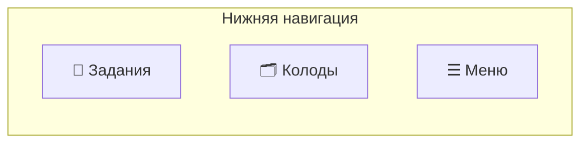
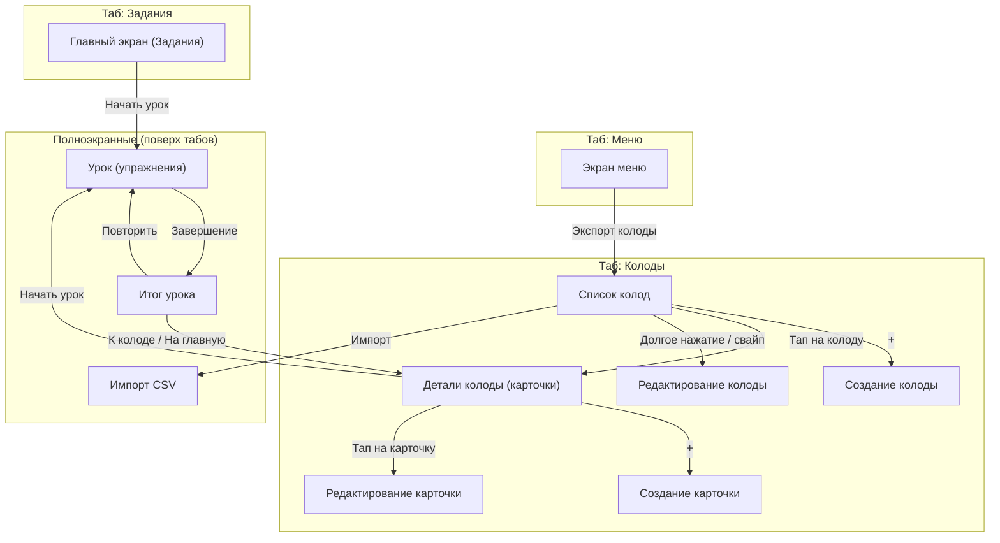
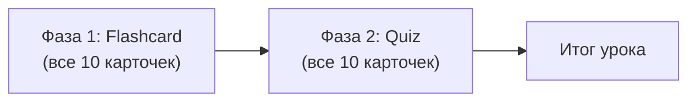
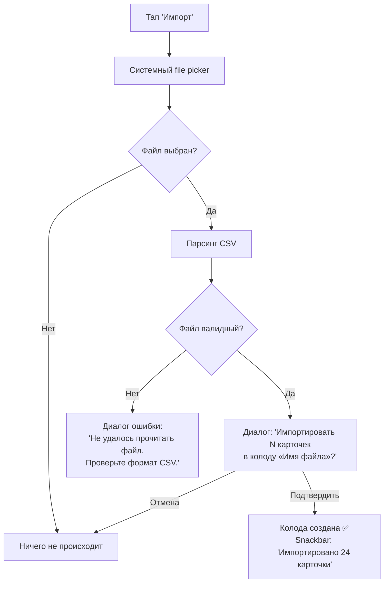
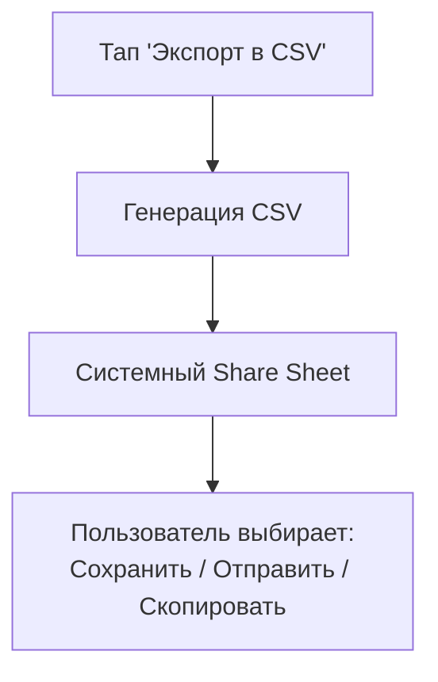

# Repetrail — User Flow

> **Описание:** Полное описание пользовательского флоу, экранов, их содержимого и доступных действий.
> **Дата создания:** 2026-11-04

---

## Обзор навигации

Приложение использует **нижнюю навигацию** с тремя табами:



Каждый таб имеет собственный стек навигации. Переключение между табами сохраняет состояние стека.

---

## Карта экранов



---

## 1. Главный экран — Задания (Tasks)

**Таб:** 📝 Задания  
**Роль:** Точка входа. Мотивация и быстрый доступ к урокам.

### Содержимое экрана

| Блок | Описание |
|---|---|
| **Приветствие** | «Привет! 👋» + текущая дата |
| **Виджет стрика** | 🔥 Текущий стрик (дней подряд). Если стрик = 0: «Начни серию сегодня!» |
| **Дневная цель** | Прогресс-бар: «Сегодня: 0/1 урок». Если выполнено: галочка + «Цель достигнута! 🎉» |
| **XP** | ⭐ Общее количество XP |
| **Карточки на повторение** | Сводка: «12 карточек ждут повторения» (суммарно по всем колодам). Если 0: «Всё повторено! Отлично!» |
| **Быстрые действия** | Список колод, в которых есть карточки на повторение, с кнопкой «Начать урок» у каждой |

### Пустое состояние (нет колод)
- Иллюстрация + текст: «У тебя пока нет колод»
- Кнопка: «Создать первую колоду» → переход на таб Колоды → экран создания колоды

### Действия пользователя

| Действие | Результат |
|---|---|
| Тап «Начать урок» у колоды | → Полноэкранный экран урока (Lesson) для выбранной колоды |
| Тап на сводку карточек на повторение | → Переход на таб Колоды |
| Тап «Создать первую колоду» (empty state) | → Таб Колоды → Создание колоды |

---

## 2. Список колод (Deck List)

**Таб:** 🗂 Колоды  
**Роль:** Управление всеми колодами.

### Содержимое экрана

| Элемент | Описание |
|---|---|
| **Заголовок** | «Мои колоды» |
| **Кнопка +** | FAB (Floating Action Button) — создание новой колоды |
| **Кнопка импорта** | Иконка в toolbar — импорт колоды из CSV |
| **Список колод** | Карточки с информацией о каждой колоде |

### Карточка колоды в списке

| Поле | Описание |
|---|---|
| **Название** | Название колоды (жирный шрифт) |
| **Описание** | Описание колоды (1-2 строки, обрезается) |
| **Кол-во карточек** | «24 карточки» |
| **На повторение** | «5 на повторение» (если есть, выделено цветом) |
| **Прогресс Leitner** | Мини-индикатор: распределение карточек по коробкам (5 сегментов) |

### Пустое состояние
- Иллюстрация + текст: «Пока нет ни одной колоды»
- Кнопка: «Создать колоду»
- Кнопка: «Импортировать из CSV»

### Действия пользователя

| Действие | Результат |
|---|---|
| Тап на колоду | → Экран деталей колоды (список карточек) |
| Тап на FAB (+) | → Экран создания колоды |
| Тап на иконку импорта | → Системный file picker → парсинг CSV → создание колоды |
| Свайп влево по колоде | Появляются кнопки: ✏️ Редактировать / 🗑 Удалить |
| Долгое нажатие на колоду | Контекстное меню: Редактировать / Экспорт в CSV / Удалить |

---

## 3. Создание / Редактирование колоды

**Навигация:** Открывается поверх списка колод (push в стек таба Колоды).  
**Роль:** Ввод/изменение данных колоды.

### Содержимое экрана

| Поле | Тип | Обязательное | Описание |
|---|---|---|---|
| **Название** | Текстовое поле | ✅ | Название колоды (макс. 100 символов) |
| **Описание** | Многострочное текстовое поле | ❌ | Описание колоды (макс. 500 символов) |

### Toolbar

| Элемент | Описание |
|---|---|
| **← Назад** | Возврат без сохранения (с подтверждением, если были изменения) |
| **Заголовок** | «Новая колода» или «Редактирование колоды» |

### Кнопки

| Кнопка | Описание |
|---|---|
| **Сохранить** | Нижняя кнопка на всю ширину. Активна только при заполненном названии. Сохраняет и возвращает на предыдущий экран |

### Валидация
- Название не может быть пустым — показывается ошибка под полем: «Введите название колоды»
- При попытке уйти с несохранёнными изменениями — диалог: «Отменить изменения?» → Да / Нет

### Действия пользователя

| Действие | Результат |
|---|---|
| Заполнить поля + тап «Сохранить» | Колода создаётся/обновляется в БД → возврат к списку колод |
| Тап ← (с изменениями) | Диалог подтверждения → отмена или возврат |
| Тап ← (без изменений) | Возврат к предыдущему экрану |

---

## 4. Детали колоды (список карточек)

**Навигация:** Открывается из списка колод (push в стек таба Колоды).  
**Роль:** Просмотр карточек, запуск урока, управление карточками.

### Содержимое экрана

| Элемент | Описание |
|---|---|
| **Toolbar** | ← Назад, название колоды, меню (⋮) |
| **Шапка** | Описание колоды, статистика: всего карточек / на повторение / выучено |
| **Кнопка «Начать урок»** | Заметная кнопка. Недоступна если карточек < 1 |
| **Список карточек** | Все карточки колоды |
| **FAB (+)** | Создание новой карточки |

### Карточка в списке

| Поле | Описание |
|---|---|
| **Термин** | Основной текст (жирный) |
| **Определение** | Вторичный текст (серый, обрезается до 2 строк) |
| **Коробка Leitner** | Бейдж: «Коробка 3» (цвет зависит от номера: 1 = красный, 5 = зелёный) |
| **Статус** | «Новая» / «На повторение» / «Выучена» (box 5 + nextReviewAt > сегодня + 30 дней) |

### Статистика в шапке

| Метрика | Описание |
|---|---|
| **Всего** | Общее количество карточек |
| **На повторение** | Карточки с `nextReviewAt ≤ сегодня` |
| **Новые** | Карточки, которые ещё ни разу не повторялись (`lastReviewedAt == null`) |
| **Выучены** | Карточки в box 5, не требующие повторения |

### Меню (⋮) в toolbar

| Пункт | Действие |
|---|---|
| Редактировать колоду | → Экран редактирования колоды |
| Экспорт в CSV | Генерация CSV → системный share sheet |
| Удалить колоду | Диалог подтверждения → удаление с каскадом карточек → возврат к списку колод |

### Пустое состояние (нет карточек)
- Иллюстрация + текст: «В этой колоде пока нет карточек»
- Кнопка: «Добавить первую карточку»
- Кнопка «Начать урок» — неактивна (серая) с пояснением: «Добавьте хотя бы одну карточку»

### Действия пользователя

| Действие | Результат |
|---|---|
| Тап на карточку | → Экран редактирования карточки |
| Тап FAB (+) | → Экран создания карточки |
| Тап «Начать урок» | → Полноэкранный экран урока |
| Долгое нажатие на карточку | Обычное dropdown-меню: Редактировать / Удалить |
| Выбор «Редактировать» в меню карточки | → Экран редактирования карточки |
| Выбор «Удалить» в меню карточки | Немедленное удаление из БД без дополнительного подтверждения, snackbar и undo |
| Тап ← | → Возврат к списку колод |

---

## 5. Создание / Редактирование карточки

**Навигация:** Открывается поверх деталей колоды.  
**Роль:** Ввод/изменение данных одной карточки.

### Содержимое экрана

| Поле | Тип | Обязательное | Описание |
|---|---|---|---|
| **Термин** | Текстовое поле | ✅ | Слово или фраза для запоминания |
| **Определение** | Многострочное текстовое поле | ✅ | Перевод, объяснение или ответ |
| **Пример** | Многострочное текстовое поле | ❌ | Пример использования (подсказка: «The dog is barking») |

### Toolbar

| Элемент | Описание |
|---|---|
| **← Назад** | Возврат без сохранения (с подтверждением, если были изменения) |
| **Заголовок** | «Новая карточка» или «Редактирование карточки» |

### Кнопки

| Кнопка | Описание |
|---|---|
| **Сохранить** | Нижняя кнопка. Активна при заполненных обязательных полях |
| **Сохранить и добавить ещё** | Вторичная кнопка (только при создании). Сохраняет карточку, очищает поля, остаётся на экране |

### Валидация
- Термин и определение не могут быть пустыми
- Ошибка под пустым полем: «Обязательное поле»

### Действия пользователя

| Действие | Результат |
|---|---|
| Заполнить + «Сохранить» | Карточка сохраняется → возврат к деталям колоды |
| Заполнить + «Сохранить и добавить ещё» | Карточка сохраняется → поля очищаются → можно вводить следующую |
| Тап ← (с изменениями) | Диалог подтверждения |

---

## 6. Экран урока (Lesson)

**Навигация:** Полноэкранный, поверх табов (системная кнопка «назад» недоступна или показывает диалог подтверждения выхода).  
**Роль:** Прохождение урока из 10 карточек.

### Структура урока

Урок состоит из **двух фаз**, каждая карточка проходит обе:



### 6a. Фаза Flashcard

| Элемент | Описание |
|---|---|
| **Прогресс-бар** | Сверху экрана. Показывает: «3 / 20» (позиция из общего числа упражнений, всего 10 flashcard + 10 quiz) |
| **Тип упражнения** | Лейбл: «Flashcard» |
| **Карточка (лицевая сторона)** | Крупно: **Термин** |
| **Кнопка «Показать ответ»** | Центральная кнопка |

После нажатия «Показать ответ»:

| Элемент | Описание |
|---|---|
| **Карточка (оборотная сторона)** | **Определение** (крупно) + **Пример** (если есть, курсивом, мельче) |
| **Кнопка «Не знаю» ❌** | Левая кнопка (красный акцент) |
| **Кнопка «Знаю» ✅** | Правая кнопка (зелёный акцент) |

> **Анимация:** При нажатии «Показать ответ» карточка анимируется с эффектом переворота (flip).

### 6b. Фаза Quiz

| Элемент | Описание |
|---|---|
| **Прогресс-бар** | Продолжение от flashcard-фазы: «13 / 20» |
| **Тип упражнения** | Лейбл: «Тест» |
| **Вопрос** | Крупно: **Термин** |
| **4 варианта ответа** | Кнопки с вариантами определений (1 правильный + 3 случайных из этой колоды) |

После выбора ответа:

| Состояние | Визуал |
|---|---|
| **Правильный ответ** | Выбранная кнопка — зелёная ✅ |
| **Неправильный ответ** | Выбранная кнопка — красная ❌, правильная — подсвечивается зелёным |
| **Кнопка «Далее»** | Появляется внизу, переход к следующему упражнению |

### Особый случай: < 4 карточек в колоде
Если в колоде менее 4 карточек, фаза Quiz невозможна. Урок состоит только из Flashcard-фазы (N упражнений вместо 2N).

### Выход из урока
- Кнопка ✕ (крестик) в верхнем левом углу
- При нажатии → диалог: «Выйти из урока? Прогресс не сохранится.» → Выйти / Продолжить
- При выходе → возврат на предыдущий экран (детали колоды или Tasks)

### Действия пользователя

| Действие | Результат |
|---|---|
| «Показать ответ» | Карточка переворачивается, появляются кнопки оценки |
| «Знаю» / «Не знаю» | Ответ записывается, переход к следующей карточке |
| Выбор варианта в Quiz | Подсветка правильного/неправильного, появляется «Далее» |
| «Далее» | Переход к следующему упражнению |
| ✕ (выход) | Диалог подтверждения → выход без сохранения |

---

## 7. Итог урока (Lesson Result)

**Навигация:** Полноэкранный, заменяет экран урока.  
**Роль:** Отображение результатов, мотивация.

### Содержимое экрана

| Блок | Описание |
|---|---|
| **Заголовок** | «Урок завершён!» (или «Отличная работа!» при >= 80% правильных) |
| **Анимация** | Confetti-анимация при >= 80% правильных |
| **Статистика** | Круговая диаграмма или числа: ✅ Правильных: 8 / ❌ Неправильных: 2 |
| **Процент** | Крупно: «80%» |
| **XP** | «+10 XP заработано ⭐» |
| **Стрик** | «🔥 Серия: 5 дней!» (если обновился) |
| **Дневная цель** | «✅ Дневная цель достигнута!» (если это первый урок сегодня) |

### Раздел «Ошибки» (если есть)

Свёрнутый по умолчанию список (разворачивается по тапу на заголовок «Разбор ошибок (2)»):

| Поле | Описание |
|---|---|
| **Термин** | Слово, в котором ошибся |
| **Твой ответ** | Что выбрал/ответил пользователь (красным) |
| **Правильный ответ** | Верное определение (зелёным) |

### Кнопки

| Кнопка | Описание |
|---|---|
| **Повторить урок** | Запускает новый урок с теми же карточками (primary button) |
| **К колоде** | Возврат к экрану деталей колоды (secondary button) |
| **На главную** | Возврат на таб Задания (text button) |

### Действия пользователя

| Действие | Результат |
|---|---|
| «Повторить урок» | → Новый экран урока с теми же карточками |
| «К колоде» | → Детали колоды |
| «На главную» | → Таб Задания |
| Развернуть «Разбор ошибок» | Показывается список ошибок |

---

## 8. Экран меню (Menu)

**Таб:** ☰ Меню  
**Роль:** Профиль пользователя, настройки, служебные функции.

### Содержимое экрана

| Блок | Описание |
|---|---|
| **Профиль** | Аватар (заглушка), общий XP, текущий стрик, лучший стрик |
| **Статистика** | Всего уроков пройдено, всего карточек выучено |
| **Действия** | Список пунктов меню (см. ниже) |

### Пункты меню

| Пункт | Действие |
|---|---|
| **Импорт колоды (CSV)** | → Системный file picker → парсинг CSV → создание колоды |
| **О приложении** | → Экран/диалог: версия, ссылки |
| **Сбросить прогресс** | Диалог подтверждения → сброс XP, стрика (колоды и карточки сохраняются) |

### Действия пользователя

| Действие | Результат |
|---|---|
| Тап на «Импорт колоды» | → File picker → импорт |
| Тап на «О приложении» | → Информационный экран/диалог |
| Тап на «Сбросить прогресс» | → Диалог подтверждения → сброс |

---

## 9. Импорт CSV

**Навигация:** Системный file picker (нативный диалог выбора файла).  
**Роль:** Загрузка колоды из CSV-файла.

### Флоу



### Формат CSV

```
term;definition;example
"Dog";"Собака";"The dog is barking"
"Cat";"Кошка";""
```

- Разделитель: `;`
- Кодировка: UTF-8 (с BOM для совместимости с Excel)
- Первая строка — заголовок (пропускается)
- Поле `example` может быть пустым

---

## 10. Экспорт CSV

**Навигация:** Вызывается из меню (⋮) на экране деталей колоды или через долгое нажатие на колоду в списке.

### Флоу



- Имя файла = название колоды + `.csv` (например, `English_B2.csv`)
- Формат — аналогичен импорту

---

## Сводная таблица экранов

| # | Экран | Таб / Тип | Откуда доступен | Основное действие |
|---|---|---|---|---|
| 1 | Задания (Tasks) | 📝 Таб | Всегда | Быстрый старт урока, прогресс |
| 2 | Список колод | 🗂 Таб | Всегда | Управление колодами |
| 3 | Создание/Ред. колоды | 🗂 Push | Список колод | Ввод названия и описания |
| 4 | Детали колоды | 🗂 Push | Список колод | Просмотр карточек, старт урока |
| 5 | Создание/Ред. карточки | 🗂 Push | Детали колоды | Ввод термина и определения |
| 6 | Урок | Fullscreen | Tasks / Детали колоды | Прохождение упражнений |
| 7 | Итог урока | Fullscreen | Урок (автоматически) | Просмотр результатов |
| 8 | Меню | ☰ Таб | Всегда | Профиль, импорт, настройки |

---

## Диалоги и Snackbar

### Диалоги подтверждения

| Контекст | Заголовок | Текст | Кнопки |
|---|---|---|---|
| Удаление колоды | «Удалить колоду?» | «Колода «{name}» и все её карточки ({N}) будут удалены. Это нельзя отменить.» | Отмена / Удалить |
| Выход из урока | «Выйти из урока?» | «Прогресс текущего урока не сохранится.» | Продолжить / Выйти |
| Отмена редактирования | «Отменить изменения?» | «Несохранённые изменения будут потеряны.» | Нет / Да |
| Сброс прогресса | «Сбросить прогресс?» | «XP и стрик будут сброшены. Колоды и карточки сохранятся.» | Отмена / Сбросить |
| Подтверждение импорта | «Импортировать колоду?» | «Будет создана колода «{filename}» с {N} карточками.» | Отмена / Импортировать |

### Snackbar-уведомления

| Событие | Текст |
|---|---|
| Колода создана | «Колода «{name}» создана» |
| Колода удалена | Сейчас snackbar не показывается: подтверждение в bottom sheet сразу удаляет колоду из БД. Snackbar с undo не реализован, запланирован на будущее. |
| Карточка создана | «Карточка добавлена» |
| Импорт успешен | «Импортировано {N} карточек в колоду «{name}»» |
| Ошибка импорта | «Не удалось импортировать файл. Проверьте формат.» |
| Экспорт успешен | «Колода экспортирована» |

---

## Состояния экранов

### Loading (Загрузка)
Все экраны с данными из БД показывают **skeleton loader** (мерцающие плейсхолдеры) на время загрузки. Не используем крутящиеся спиннеры — skeleton даёт более плавный UX.

### Empty State (Пустое состояние)
Каждый экран со списками имеет осмысленное пустое состояние:

| Экран | Текст | CTA (кнопка) |
|---|---|---|
| Задания (нет колод) | «У тебя пока нет колод. Создай первую!» | «Создать колоду» |
| Задания (нет повторений) | «Все карточки повторены! 🎉 Возвращайся завтра» | — |
| Список колод | «Пока нет ни одной колоды» | «Создать колоду» / «Импортировать CSV» |
| Детали колоды (нет карточек) | «В этой колоде пока нет карточек» | «Добавить карточку» |

### Error State (Ошибка)
- При ошибке чтения из БД (маловероятно для локальной БД): полноэкранное сообщение «Что-то пошло не так» + кнопка «Попробовать снова»
- При ошибке импорта CSV: диалог с описанием проблемы

---

## Навигация назад (Back)

| Экран | Кнопка «Назад» | Системный back gesture |
|---|---|---|
| Задания / Колоды / Меню (табы) | — | Выход из приложения (или свернуть) |
| Создание/Ред. колоды | ← к списку колод (подтверждение если есть изменения) | То же |
| Детали колоды | ← к списку колод | То же |
| Создание/Ред. карточки | ← к деталям колоды (подтверждение если есть изменения) | То же |
| Урок | ✕ с диалогом подтверждения | Диалог подтверждения |
| Итог урока | Нет кнопки назад (только «К колоде» / «На главную») | → К деталям колоды |
